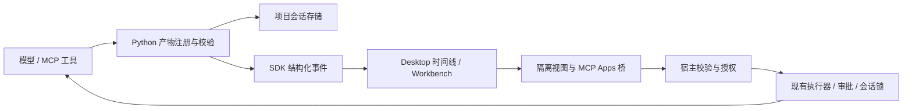

# Reverie Intelligent UI：调研、技术规格与 AI 开发交接

2026-10-24：Linux 当前包 **25dc25402c61887e** 已通过源码核对、Python **2284/24**、Desktop **387/1**、原生 P2/P3/P4 **24/26/31** 与隔离 **36**。原正式轮次及 native8 候选的失败保留，质量门仍未通过；当前执行新的完整双模型开发组。数值、原生按钮、框架等待、主题重绘修正及单次性能条件见[本次通用修正和验收](verification/2026-10-21-riu-completion/generic-batch-native9.md)。

初版调研日期：**2026-10-08**；P3 官方契约复核：**2026-10-16**；产品体验资料再次复核：**2026-10-20**。P0–P2 已在 Windows 本地验证，P3 当前实现的协议范围见下方 profile；P4 已实现并完成 2026-10-17 Windows 本地验收，后续提示词修复与真实模型生成质量见 [续验记录](VERIFICATION_HISTORY.md#riu-prompt-quality-2026-10-17)。适用基线：本轮 RIU 续修源码及 [Cloud 暂停交接](CLOUD_CODEX_RIU_HANDOFF.md)，核心与 Desktop 版本均为 `2.5.0`，核心接口版本为 `1.0`；不能用旧 HEAD 或已发布安装包代替这些源码。

本文定义待开发能力、实现约束、分期验收和可直接复制的 AI 提示词。当前能力以 [FEATURE_STATUS](FEATURE_STATUS.md) 为准，排期及状态只在 [ROADMAP](ROADMAP.md) 维护。本文中的模块名、动作、字段与限制是 **Reverie 设计约定**，除特别注明外均不是 OpenAI 的内部实现或公开 API。

## 1. 联网核实：ChatGPT 的相关能力是什么

2026-10-08 初版用官方文档搜索与网页搜索检索了 `ChatGPT intelligent UI`、交互式可视化、MCP Apps、插件扩展及桥接协议，并实际读取下列官方页面。**当时没有在所检索的官方资料中确认“Intelligent UI”是一个正式发布名称**，也没有证据把这些能力归到同一次新发布；保留这一历史调研范围。

2026-10-20 重新读取 [Intelligent UI in ChatGPT](https://help.openai.com/en/articles/20001598-intelligent-ui-in-chatgpt)：官方当前用 Intelligent UI 描述按任务自动组织文本、视觉与交互内容的产品体验，简单问题仍可用文本。它不是供任意模型直接复刻该效果的兼容协议或质量保证。Reverie 的目标是用户不必刻意说 HTML/页面，模型也能在有实际交互价值时选择合适形式；当前实现和提示词不能据此宣称功能对等或超越。最新 [UI 指南](https://developers.openai.com/plugins/concepts/ui-guidelines)支持轻量任务内容与按空间需求选择展示位置；约 400px PiP 中应优先结果和关键控件，不能以大仪表盘模板替代任务需求。

自动选择指导、Harness 与 Markdown 排版修复已包含在 2026-10-23 验收的 Linux 构建 `3824bc06ee6c6e24`，源码回归和确定性消费者验收见[继续实施记录](VERIFICATION_HISTORY.md#riu-completion-2026-10-22)；Windows 最终包与真实两模型质量门分别保留，原[暂停证据](VERIFICATION_HISTORY.md#riu-cloud-handoff-2026-10-20)不改写。本轮还加入表面及 SVG 标签配色、实际列表筛选、成功页再次编辑与安全初始化接线指导；恢复/纯重算不访问尚未返回的保存对象，真实用户操作在初始化后保存。旧会话摘要与作者建议分开投影，原工具结果和历史不改写。思考指导前置且不重复，终端与专用模式提示保持原样。原生思考按原始内容保存，Markdown 块布局使用正常空白规则、代码块保留缩进；这不授权删除/隐藏思考。完整请求、首输出、有效工具、工具执行和本地帧渲染按各自计时边界记录，不能只用提示词字符数解释生成耗时。

当前作者指导要求约 400×400 首屏先显示一个清晰主要结果及关键输入，再安排次要指标和图表；新增控制条件应真正支配派生值，零、false 和空字符串按属性存在性恢复。完整宿主示例在通用工程指导之前，只出现一次。`render_view` 的缺失集成提醒是非阻断反馈，不改写原 HTML，也不能证明运行正确。质量验证按业务语义和真实操作验收，兼容内联或独立确认页、按钮或整卡选择、SVG 或 CSS 柱状图等实现；不得为了通过而限定单一模板。

| 官方能力 | 已核实的产品行为 | Reverie 对标范围 |
| --- | --- | --- |
| [Visualizations](https://learn.chatgpt.com/docs/visualizations) | 在聊天中生成可操作的图表、地图、解释、计算器与模拟器；可主动选择，也可用 `@Visualize`；桌面预览按账户与平台逐步开放 | 对话内生成视图、滑块/筛选/选择、继续追问、离线重看 |
| [MCP Apps UI](https://developers.openai.com/plugins/build/chatgpt-ui) | 工具声明 UI 资源，宿主以隔离组件显示，组件通过 MCP Apps 桥与宿主通信 | 兼容明确测试过的标准协议子集，支持已有 MCP 服务器的组件 |
| [Plugin Extensions](https://developers.openai.com/plugins/build/extensions) | 扩展侧栏、对话面板、文件查看器、编辑器、表单与上下文联动 | 先复用 Workbench 承载扩展视图；完整第三方扩展清单与生命周期另行规划 |

Visualizations 页面明确：结果通常是生成时的数据快照；追问**可能**生成替代版本，并非保证原地修改；终端和 IDE 扩展不渲染这些可视化。页面中的 `/visualize` 是 **Space 页面编辑**入口，不能写成所有聊天都有的斜杠命令。托管应用与持久业务数据属于 Sites 等另一类产品范围。可用性、首次发布日期和当前账户开关不能从搜索结果推断。[官方使用说明](https://learn.chatgpt.com/docs/visualizations)

可移植 UI 的公开依据是 MCP Apps。`window.openai` 属于 ChatGPT 扩展接口，不是所有宿主都会具备的标准能力；“支持 MCP Apps”不能直接等同“所有 ChatGPT 插件原样运行”。工具自身必须在没有组件的客户端也有有用的结果。[官方 UI 接入说明](https://developers.openai.com/plugins/build/chatgpt-ui)

DevDay 页面列出了 Plugin Extensions，但这不能证明 ChatGPT 的可视化生成与第三方组件共用同一套内部生成器。Reverie 可以实现类似公开体验，不能承诺相同模型质量、闭源协议、账户体系或云端服务。[DevDay 2026 扩展公告](https://learn.chatgpt.com/docs/whats-new/devday-2026#plugin-extensions)

### 1.1 可用于开发的公开契约

2026-10-20 Cloud 再核对官方 Intelligent UI 与 UI guidelines：按任务选择文本/交互，PiP 避免承载过多控件，普通计算问答无需视图。Cloud 已构建 Linux `f83a5d6f50971c66`；上文“未打包”保留为暂停时的 Windows 状态。新质量矩阵默认每条样本分别启动 Desktop，拥有独立工作区、记忆和 profile；`--shared-profile` 仅用于标明范围的历史对照。目录、匿名文本、SSE、工具闭环和业务断言分别验收。见 [本轮记录](VERIFICATION_HISTORY.md#riu-cloud-runtime-2026-10-20)。

2026-10-21 该矩阵已完整结束：15 个生成样本质量通过 0，3 个普通文本对照通过 3；无视图、已证实的语义失败、上游服务错误分开报告，不以注册成功替代业务验收。新增 MiniCPM 免费接口核对仅证明公开 Gradio/SSE 文本可用，未证明标准 tools 或 RIU 工具闭环。

| 契约 | 官方依据 | 使用边界 |
| --- | --- | --- |
| `_meta.ui.resourceUri`、`ui://`、`text/html;profile=mcp-app` | [UI 接入](https://developers.openai.com/plugins/build/chatgpt-ui) | 前者是工具描述上的资源指针；HTML 与 CSP 元数据来自资源内容；不能把 `ui://` 当 HTTP URL |
| `ui/initialize`、`ui/notifications/initialized`、`tools/call`、工具结果通知 | [MCP server and UI quickstart](https://developers.openai.com/plugins/build/app-quickstart) | 先协商协议与能力，再发送完整输入/结果；以固定 SDK/协议版本做兼容测试 |
| `content` / `structuredContent` / `_meta` | [Tool results reference](https://developers.openai.com/plugins/reference#tool-results) | 前两者可给模型，结果 `_meta` 仅供组件；不等于可在 `_meta` 塞宿主凭据 |
| `_meta.ui.visibility` | [Tool descriptor reference](https://developers.openai.com/plugins/reference) | 区分 `model`、`app` 可见性；客户端还须执行自身授权 |
| `connectDomains` / `resourceDomains` / `frameDomains` | [Security & Privacy](https://developers.openai.com/plugins/guides/security-privacy) | 服务端声明是权限请求，不是自动授权；嵌套页面有自己的 CSP，外层 allowlist 不约束其全部请求 |
| inline、fullscreen、pip；card、carousel | [UI guidelines](https://developers.openai.com/plugins/concepts/ui-guidelines) | 前三者为展示模式，后两者是内容布局；不应把 carousel 当标准 display mode |

初次读取日期为 2026-10-08。2026-10-16 实施 P3 前重新读取 [UI](https://developers.openai.com/plugins/build/chatgpt-ui)、[quickstart](https://developers.openai.com/plugins/build/app-quickstart)、[reference](https://developers.openai.com/plugins/reference) 全文，并对照 [ext-apps v2.0.3 类型契约](https://github.com/modelcontextprotocol/ext-apps/blob/v2.0.3/src/spec.types.ts) 和 [发布说明](https://github.com/modelcontextprotocol/ext-apps/releases/tag/v2.0.3)。SDK 固定 `2.0.3`，UI 协议固定 `2026-01-26`，测试依赖及传递依赖固定在 [fixture lockfile](../scripts/verification/fixtures/mcp-apps/package-lock.json)。没有安装 ChatGPT 插件或调用付费模型验证账户侧行为。

## 2. 当前项目审查与差距

以下保留 2026-10-08 初版源码审查基线，描述实现前的差距；当前状态见第 4.4 节 P3 profile、[FEATURE_STATUS](FEATURE_STATUS.md) 与集中验证记录。

| 层 | 已有实现与源码入口 | RIU 缺口 |
| --- | --- | --- |
| 对话显示 | [App.tsx](../ReverieCli-ui/src/App.tsx) 中 `Markdown` 使用 `react-markdown` 与 `remark-gfm`；处理链接与代码；`ui.event` 进入活动流 | 无生成 HTML 执行入口，也无可交互视图片段；不能通过开启 Markdown raw HTML 来实现 |
| 时间线 | [types.ts](../ReverieCli-ui/src/types.ts) 的 `TurnSegment` 只有 assistant/reasoning/activity；[live-stream.ts](../ReverieCli-ui/src/live-stream.ts) 有 40 ms 批处理及活动去重 | 要增加 view 引用、版本去重与历史恢复；不能依赖最多保留 200 条的活动数组作为唯一存储 |
| 核心事件 | [stream_protocol.py](../ReverieCli-py/reverie/stream_protocol.py)、[sdk_bridge.py](../ReverieCli-py/reverie/sdk_bridge.py) 已将标记事件转成结构化流 | 可复用传输；缺可信产物注册、view_ready/view_error 和相应能力声明 |
| 双端协议 | [core-protocol.ts](../ReverieCli-ui/src/core-protocol.ts) 与 [core-actions.ts](../ReverieCli-ui/electron/core-actions.ts) 有编译期动作完整性校验 | 新增动作必须同步类型、运行时校验、preload 与 Python 分派 |
| Electron | [main.ts](../ReverieCli-ui/electron/main.ts) 已启用 contextIsolation、禁用 Node、启用 sandbox，且有外链/导航处理；[index.html](../ReverieCli-ui/index.html) 有宿主 CSP | 这些保护不等于已建立不可信子视图的来源、IPC、资源、导航、联网和进程隔离 |
| 工具执行 | [tool_executor.py](../ReverieCli-py/reverie/agent/tool_executor.py)、[security_policy.py](../ReverieCli-py/reverie/security_policy.py)、[permission_review.py](../ReverieCli-py/reverie/agent/permission_review.py)；[main.ts](../ReverieCli-ui/electron/main.ts) 管理审批归属与执行租约 | UI 回调必须接入相同执行器与审批归属，不能直接调用底层 MCP transport |
| MCP | [mcp.py](../ReverieCli-py/reverie/mcp.py) 的 `call_tool` 保留 raw result；`format_mcp_call_result` 支持 typed media、structuredContent；[mcp_dynamic.py](../ReverieCli-py/reverie/tools/mcp_dynamic.py) 取归一化结果 | 动态目录构造没有保留 UI 描述；没有 Apps 握手、资源宿主、visibility 或结果 `_meta` 专用通道；空结果兜底序列化 raw result 须避免泄露 `_meta` |
| 会话 | [session/manager.py](../ReverieCli-py/reverie/session/manager.py) 保存 messages/metadata，支持 fork/rewind/delete；[storage.py](../ReverieCli-py/reverie/storage.py) 定义项目数据位置 | 缺不可变视图产物、版本/回合归属、UI 状态及删除/分叉的引用管理 |
| 面板与 CLI | [Workbench.tsx](../ReverieCli-ui/src/Workbench.tsx)、[ConversationDisplay.tsx](../ReverieCli-ui/src/ConversationDisplay.tsx)、[cli/interface.py](../ReverieCli-py/reverie/cli/interface.py) | 可以复用面板与显示偏好，但 Workbench 还不是通用插件宿主；TUI 需要摘要降级 |

结论：基础传输和宿主已经具备，新增工作集中在**视图产物、隔离执行、可信交互、会话生命周期**。G24 记录的是更广泛 MCP 客户端边界，RIU 完成只关闭其中 UI 相关部分；单独登记 G33，避免把 roots/sampling/elicitation/OAuth 一并误标完成。

## 3. 产品内容与完成定义

### 3.1 用户应能完成的完整流程

1. 用户要求“解释这个算法并让我调参数”或“把这组数据做成交互图表”；模型在有帮助时选择 `render_view`，一般事实问答仍输出普通文本。
2. 回答中出现有标题、简短摘要和可交互内容的视图；滑块、筛选、排序等本地操作立即反馈，不逐次请求模型。
3. 用户可以放大到 Workbench，继续用正常输入框追问；新内容形成一个可追溯版本，旧版本仍可查看。
4. 对允许的视图操作，宿主展示清楚的动作来源，经现有审批执行工具或发起新对话；模型只接收与问题有关的选择摘要。
5. 刷新、重启、切换会话后能恢复产物与展示状态。CLI/旧客户端收到可读摘要、数据解释与产物引用。
6. MCP Apps 服务以公开标准返回组件；在实现所声明的兼容子集内，原有组件无需改成 Reverie 专有桥。

### 3.2 范围与优先级

| 编号 | 必须交付 | 阶段 |
| --- | --- | --- |
| F01 | `render_view` 注册本地自包含 HTML；含文本摘要/数据来源与版本；原子持久化成功后才发布事件 | MVP |
| F02 | 对话 inline 视图、加载/错误/禁用状态、键盘操作、亮暗主题、窄窗口 | MVP |
| F03 | 严格隔离、默认离线、宿主可销毁、参数校验、跨会话访问拒绝 | MVP 前置门 |
| F04 | 重启恢复、取消、fork/rewind/delete、旧客户端文本降级 | MVP |
| F05 | 受控工具回调、用户触发追问、模型上下文摘要、私有 UI 状态 | 第二阶段 |
| F06 | MCP Apps 标准子集及现成示例互操作、结果 `_meta` 分离 | 第三阶段 |
| F07 | fullscreen/Workbench 与 pip，card/carousel 布局；移动布局时状态不丢失 | 完整 RIU 验收 |

MVP 完成不等于完整 RIU 完成。Plugin Extensions 的第三方侧栏注册、文件编辑协议、富表单协议、远端 OAuth、托管分享、云端同步另列扩展范围；此次文档不授权顺带实施这些模块。后续若要求完全对齐这些能力，须分别补充其清单、权限和测试，不能将现有 Workbench 重命名后视为已实现。

首批代表场景为：带筛选的数据表/图表、带参数的解释器、带选择状态的比较卡片。MVP 不新增专用图表 DSL、完整页面搭建器或包管理器；HTML 只用打包资产或内联资源，依赖按实际场景引入。

## 4. 核心架构与数据契约



### 4.1 产物与消息分离

新增 `reverie/views.py` 管理产物，`reverie/tools/render_view.py` 作为小型工具入口；不要把存储、桥、MCP 兼容都塞进 `App.tsx` 或 `sdk_bridge.py`。

建议 `render_view` 输入为 `artifact_path`、`title`、`summary`、可选 `replaces_view_id`。文件由现有文件写入工具生成；注册时只接受当前工作区内已存在的 UTF-8 HTML 普通文件，安全打开后将读到的同一份字节验证并复制到宿主管理的产物目录。不要让模型选择存储目标、session_id、权限或网络 allowlist。新工具通过 [tools/registry.py](../ReverieCli-py/reverie/tools/registry.py) 和现有模式/工具发现机制加载。

建议目录：`<project_data_dir>/views/<session_id>/<view_id>/<revision>/`，内含 `manifest.json`、`index.html`，UI 状态另存。沿用 `storage.py` 确定 project_data_dir，不能直接假设工作区根目录的 `.reverie/` 是权威位置。

内核持久 manifest 示例，所有身份字段均由宿主生成/绑定：

```json
{
  "schema_version": 1,
  "view_id": "generated-id",
  "revision": 1,
  "session_id": "host-bound-session",
  "turn_id": "host-bound-turn",
  "tool_call_id": "originating-call",
  "title": "参数变化演示",
  "summary": "调整参数查看结果；输入数据来源见说明。",
  "source": {"kind": "generated"},
  "mime_type": "text/html",
  "entry": "index.html",
  "sha256": "digest-of-stored-bytes",
  "created_at": "ISO-8601 timestamp",
  "replaces_view_id": null,
  "policy_id": "local-offline-v1"
}
```

MCP 来源增加 `server_id`、`connection_generation`、`resource_uri`、资源版本/哈希，MIME 为协商支持的 `text/html;profile=mcp-app`。缓存键至少包含服务器身份、连接代次、资源 URI 与内容哈希，不能仅用可能跨服务器重复的 URI。服务端声明的权限与宿主实际授予的权限分开保存。

默认限制是实现起点，须通过测试后固化：单 HTML 2 MiB、私有 JSON 状态 64 KiB、模型摘要 8 KiB、bridge 消息 256 KiB；目录含全部资源的总额也要有限制。注册拒绝超限、无效 UTF-8、目录、外部路径、设备路径和链接逃逸，并返回可操作的错误。

**上下文成本边界**：模型生成 HTML、文件写入工具参数以及原有工具调用历史仍可能产生并保留 token。目标是“不要在工具结果、历史重放、会话加载和检索里再复制完整 HTML/私有状态”，不是“生成 HTML 不占 token”。不可删除工具调用原文来伪造低使用量；若后续做历史压缩，必须保留调用配对、签名和真实 API usage。

### 4.2 事件与 API 边界

`view_ready` 只携带 view 引用、标题、摘要和归属，不携带 HTML；`view_error` 携带关联 id 与脱敏错误。新增 `TurnSegment` 的 `view` 分支；按 `(session_id, turn_id, view_id, revision)` 去重，保证文字、思考、工具和视图按原发生顺序显示。

UI 的事件标记只通知“有产物可读”，不是权限凭证。任意模型文本、日志或 MCP 返回里伪造 `[[REVERIE_EVENT]]` 都不得创建可执行视图；Desktop 必须通过核心验证注册记录和会话归属。

拟新增核心动作：

| 动作 | 作用 | 服务端必须验证 |
| --- | --- | --- |
| `getView` | 读取安全 manifest/内容描述 | 当前 project/session 与 view 归属、存在性、大小、哈希；不接受任意文件路径 |
| `setViewState` | 保存 JSON 展示状态 | view 版本、state_revision、大小；陈旧写入返回冲突，不覆盖新状态 |
| `callViewTool` | 从组件调用绑定工具 | 用户操作来源、工具白名单、server 绑定、schema、权限、取消和执行租约 |

内部 payload 命名沿用现有 TypeScript `sessionId` 等约定；持久层可用 snake_case。跨层映射显式编写并测试。追问复用正常 `runPrompt`；不要增加可以绕过现有调度器的第二条聊天入口。

握手用可选 `views` capability 探测能力。P0–P2 的 `mcp_apps` 为 false；P3 的现行值为 true，并附 `mcp_apps_protocol: "2026-01-26"`、`mcp_apps_sdk: "2.0.3"`、`profile: "offline-server-tools-v1"`。TUI 仍只返回文本与产物引用。新增字段保持 `CORE_INTERFACE_VERSION` 为 1.0；真正破坏协议时才升版并同步可信内核元数据、打包与兼容性测试。

### 4.3 渲染隔离：必须先验证的技术门

候选实现是宿主拥有的 `reverie-view:` 资源协议，加 `sandbox="allow-scripts"` 的 iframe；不给 `allow-same-origin`、顶层导航、弹窗、表单或下载权限，不加 preload，不暴露 Node 或 `window.reverie`。父页面仅增加必要的 `frame-src`，不放宽父页面 `script-src`，不关闭 `webSecurity`。

本地报名或试填页面应使用 `type="button"` 的本地点击处理及页内验证/确认，必要时显式处理 Enter；原生 form submit 事件及 alert/confirm/prompt 模态弹窗受沙箱限制，不能依赖它们。2026-10-20 实际模型表单验证了“字段有效但真实点击不触发 submit”，补充作者指导而不扩大沙箱。合成 submit 事件仅用于定位，不能计入用户交互通过。

**iframe 只是候选，不是已经证明的资源隔离。** Phase 0 必须在打包 Electron 中用无限同步循环和高频消息验证：聊天仍可输入、Stop/关闭视图仍可用、主进程能销毁视图。opaque origin 与 iframe sandbox 本身并不保证独立进程。若达不到这些门槛，使用独立 sandboxed WebContentsView/BrowserWindow 承载，隔离 session、禁用 preload，并通过可信包装层转发有限消息；不能以普通页面超时定时器声称解决死循环。其 inline 布局与生命周期成本在同一技术门内验证后定案。

离线响应 CSP 起点：

```text
default-src 'none'; script-src 'unsafe-inline'; style-src 'unsafe-inline';
img-src data: blob:; font-src 'none'; media-src data: blob:;
connect-src 'none'; frame-src 'none'; worker-src 'none';
object-src 'none'; base-uri 'none'; form-action 'none'
```

这允许隔离视图中的内联脚本，不允许宿主执行该脚本。CSP 不是全部权限边界：主进程还要拒绝子视图自导航/重定向、window.open、下载、协议跳转、摄像头/麦克风/定位/通知等权限请求；`connect-src 'none'` 不能单独证明没有导航或外传路径。

资源协议只能按已绑定的 view ID 和入口映射取文件，检查 Windows 盘符、UNC、编码路径穿越、junction/symlink 及检查后替换问题；不能提供通用 `file://` 读取代理。所有有特权的 Electron IPC 都须校验 **senderFrame/顶层宿主身份**，不能只看 `event.sender` 或认为子 frame 没 preload 就绝对安全。

### 4.4 桥：优先标准，最少私有扩展

内置生成视图与 MCP 视图共用宿主执行控制器。对第三方保持标准 JSON-RPC 方法，避免先造 `riu/*` 再声称与 MCP Apps 自动兼容。标准名称不代表完整协议已经实现；实现时固定 SDK/规范版本及 capability profile。

| 方法/生命周期 | 宿主行为 |
| --- | --- |
| `ui/initialize` → `ui/notifications/initialized` | 协商版本、hostContext、主题/语言/尺寸与能力；就绪前排队有限条消息 |
| `ui/notifications/tool-input` / `ui/notifications/tool-result` | 审批完成后发送当前实例输入与结果；同一数据更新尽量保留视图实例 |
| `tools/call` | 仅执行该组件所属服务器、当前启用且允许 app 可见的工具；走 `callViewTool` |
| `ui/message` | 用户操作触发时进入常规追问流程；组件启动或自动定时器不能冒充用户发送 |
| `ui/update-model-context` | 记录有大小上限、带视图来源的选择摘要；视为不可信用户数据，绝不升级为系统指令 |
| 展示/尺寸/hostContext 更新 | 只声明实际实现的协议能力，夹取尺寸并节流；拒绝非法/未知请求，返回 JSON-RPC 错误 |
| 私有 `reverie/view-state` | 仅内置视图用，feature-detect；映射 `setViewState`，不冒充标准持久化 API |

iframe 模式验证 `event.source === registeredFrame.contentWindow`；opaque origin 的 `"null"` 本身不是身份。绑定随机实例 capability、session/view/revision、请求 id 和握手状态；导航、重载、切换会话时使旧实例失效。发送给 opaque frame 时若必须用 `targetOrigin="*"`，仍必须限定目标 window，且不发送宿主密钥。独立 WebContents 模式使用相同约束的受控消息通道。对消息大小、速率、并发、超时、重复和取消均有上限。

**P2 实施 profile（2026-10-15）**：方法与文本内容形状对照固定的 [ext-apps v1.2.0 类型契约](https://github.com/modelcontextprotocol/ext-apps/blob/v1.2.0/src/spec.types.ts)，协议版本 `2026-01-26`。当前只承载内置离线生成视图：`initialize/initialized`、`tools/call`、文本 `ui/message`、文本/JSON `ui/update-model-context` 和私有 `reverie/view-state`；旧私有 `reverie/call-tool` 保留为别名。握手的 experimental capability 标明内置工具与私有状态；不声明 `serverTools`，核心 `mcp_apps` 仍为 false。第三方资源、服务器/连接代次/app visibility 绑定、工具初始输入/结果通知、动态 hostContext、展示模式协商仍按 P3/P4 验收，不能由此宣称标准组件完全兼容。

组件的 `source` 不能证明用户动作。工具请求始终以 component 来源进入现有 executor / security_policy / permission_review / 审批 gate，并逐次等待宿主审批；会话批准不能替代这次确认。`ui/message` 只形成宿主建议，用户点击宿主“发送追问”后才进入正常 `runPrompt`；组件启动消息与定时消息不会自动调用模型。上下文摘要只在后续模型请求中作为带 view/revision 来源的不可信 user 数据临时注入，不写入系统指令或消息历史。

P2 固化的上限：HTML 2 MiB、资源包 8 MiB、私有 JSON 状态 64 KiB、模型摘要合计 8 KiB、桥消息 256 KiB、每实例同时等待 8 个请求、每秒 64 条消息、每实例最多 1,024 个请求 ID。普通请求超时 10 秒，审批工具请求 330 秒；超时释放宿主执行实例并拒绝迟到结果。状态包含内容 revision 和乐观 `baseRevision`；状态、摘要与写前收据位于可执行 HTML 目录之外。写前收据最多 1,024 条/8 MiB，完成、拒绝、Stop 都消耗操作 ID；崩溃/断连留下的 unknown 收据只能查询，不能自动重放。新操作需显式使用新的操作 ID。

#### P3 固定兼容 profile：offline-server-tools-v1

P3 对照 ext-apps `2.0.3` / UI 协议 `2026-01-26`。Reverie 宿主直接接收标准 JSON-RPC over postMessage，不要求标准组件加入 capability、sessionId 或 `riu/*` 字段；身份由已注册 frame 的 Window、宿主实例租约、会话与 revision 约束。原有生成视图保留 P2 capability envelope。MCP 核心 transport 请求 `2025-06-18`，接受并固定服务器返回的 `2025-06-18` 或 `2025-11-25`，HTTP 后续头使用协商值；其他核心版本拒绝。原版官方示例的实际版本和包内证据见 [P3 验证](VERIFICATION_HISTORY.md#riu-p3-interop-2026-10-16)。

| 协议 / 数据面 | 实现与边界 | 状态 |
| --- | --- | --- |
| 工具 `_meta.ui.resourceUri`、`visibility` | MCP 目录保留原描述元数据；默认 model/app；app-only 不进入模型 schemas、tool_catalog/search/list，也拒绝模型猜名执行；非法 visibility 隐藏 | 支持 |
| `openai/outputTemplate` | 仅作为资源指针别名，标准 `resourceUri` 优先；不会注入 `window.openai` | 支持 |
| `resources/read` + `ui://` | 单个自包含 `text/html;profile=mcp-app` 文本资源，HTML 上限 2 MiB；URI 与实际响应一致；错误 MIME、路径、缺资源、超限回退工具文本 | 支持 |
| CSP / permissions | 分别保存资源请求的 UI 策略与宿主空授权；继续使用隔离宿主离线 CSP。请求非空外部 origins、嵌套 frame、浏览器权限或 legacy CSP 均拒绝，保留文本结果 | 拒绝扩权 |
| 缓存身份 | server/config 摘要、真实 transport connection nonce、资源 URI、HTML hash 和资源 UI 策略共同组成身份；不把同 URI 或重连视为同授权 | 支持 |
| `content` / `structuredContent` / `_meta` | 前两者给模型；结果 `_meta` 只随私有 hydration/工具回调给组件，不进入 ToolResult.data、模型请求、公共 view reference、工具审计事件或对话。只有 `_meta` 时提供通用文本，不 dump raw result | 支持 |
| hydration / 恢复 | 输入与原始结果合计上限 200 KiB，存于可服务目录之外；getView 的私有部分只给宿主/组件；fork 复制快照，删除移除；MCP 结果引用可恢复为时间线视图 | 支持 |
| `ui/initialize` / `ui/notifications/initialized` | 固定版本与 appInfo/capabilities 校验；只声明 serverTools、text message、text/JSON model-context、离线 sandbox；就绪前不发送私有输入/结果 | 支持 |
| `ui/notifications/tool-input` / `tool-result` | initialized 后按顺序发送完整 arguments 和原始 CallToolResult，包含组件私有 `_meta`；每实例一次；回调直接返回原始结果 | 支持 |
| `tools/call` | 仅绑定服务器、原连接代次、当前模式、app visibility 与初始 allowlist 的交集，最多 32 个工具；Writer 模式拒绝 MCP 回调；进入原 coordinator/worker/executor/security_policy/permission_review/审批链；每实例请求 ID 命名空间与持久收据阻止重放 | 支持 |
| 工具错误 / 拒绝 | 服务器 `isError` 原样作为工具结果；宿主拒绝、旧连接和非法调用给 JSON-RPC 错误；迟到结果不投递 | 支持 |
| `ui/message` | 仅 user 角色文本，8 KiB；返回接受的建议并等待宿主用户确认。组件自报 user-gesture 不触发模型 | 支持 |
| `ui/update-model-context` | text/JSON 合并摘要 8 KiB；只保留最后一次，临时作为带来源的不可信 user 数据加入下一轮，不写 system、不自动启动模型 | 支持 |
| `ui/notifications/size-changed` | 仅有限 inline 高度，120–800 px；沿用消息大小、速率上限 | 支持有限子集 |
| `ui/notifications/request-teardown` / `ui/resource-teardown` | 宿主立即撤销执行权限，发送标准 teardown，等待 ack 最多 500 ms；收起与组件主动销毁可完整握手。强制卸载/进程终止只能尽力通知，安全撤销不等 ack | 支持，强制退出无 ack 保证 |
| `ui/open-link`、download、sampling、resources proxy、UI `tools/list`、未知方法 | 不声明能力；请求返回明确 JSON-RPC 错误，通知无响应 | 拒绝 |
| host-context 动态更新、display mode 切换 | P4 增加主题/语言/尺寸/styles.variables 更新与 inline/fullscreen/pip 协商；card/carousel 仅是内容布局。实际验收状态见 G33 与验证历史 | 已实现，按 P4 证据限定验收 |
| partial input、tool-cancelled 通知、所有内容模态 | 当前完成工具后才加载组件；不声明流式工具输入或全部内容模态兼容 | 未实现 / 独立 profile |
| `window.openai`、Plugin Extensions、OAuth、外部模型/真实远程服务、非 Windows | 未声明完整兼容；不能由单个官方示例推导 | 未验证 / 范围外 |

当前回调需要原 worker 的 MCP 连接存活。空闲 worker 可能在 30 秒后回收；进程重启、连接替换或配置改变后，旧视图仍可显示已保存快照，但回调明确报连接过期。用户须重新调用原工具生成新绑定，刷新旧 HTML 不会隐式重连或重放写入。这是本 profile 的可用性边界，不能据此声称持久连接代理已实现。

标准 JSON-RPC 请求 ID 按实例命名空间隔离，不是跨重启的业务幂等键。生成视图需要跨重启查询同一写操作时，使用已有 `reverie/call-tool` 的显式持久 `callId`；unknown 收据不会重新执行。新实例发起的新操作仍逐次经过宿主审批，不能把组件按钮或同名 RPC ID 当作已获授权。

本次真实 MCP 服务仅验收 stdio / 核心协议 `2025-06-18`；HTTP/SSE UI 互操作及实际 `2025-11-25` 服务器未验证。失败资源仍给模型和用户保留原工具文本；不把通用完成提示当成服务器未提供的业务数据。

`structuredContent` 是服务端明确给模型的业务数据，内部同名字段不是结果顶层私有 `_meta`。工具描述 `_meta`、资源内容 `_meta.ui` 和结果 `_meta` 分层保存，不能把任一 `_meta` 当作授权或宿主凭据容器。实现入口为 [mcp.py](../ReverieCli-py/reverie/mcp.py)、[mcp_apps.py](../ReverieCli-py/reverie/mcp_apps.py)、[mcp_dynamic.py](../ReverieCli-py/reverie/tools/mcp_dynamic.py)、[标准生命周期](../ReverieCli-ui/src/mcp-app-lifecycle.ts)。

#### P4 展示与资源生命周期

2026-10-18 续修将提示词中的工具选择指导与 API 参数 schema 分开：模式 manifest 保留工具名称、用途、适用场景、发现与调用约束，参数由同一请求的原生 schema 提供；完整 manifest 仍可用于诊断。Desktop 生成指导保留可运行的初始化、主题与串行私有状态示例；普通问答和使用给定数据的单文件视图无需引入工程阶段或仓库检索。显式限定 create_file/render_view 的请求不会因否定读取文件的措辞而被宿主强制加入第三个检索工具；真正的代码分析/修改仍走原检索策略。摘要描述用户结果和操作，窄视图把主结果与关键控件放在前部。`rules.txt` 按其声明忽略以 `#` 开头的注释，不把默认示例当成已启用规则。流式失败响应只有原生思考时也逐次保存到会话并供界面恢复；后续 API 请求不发送无正文/工具的空 assistant 消息，但不删除或改写会话中的思考。以上均不裁剪原生工具能力。

生成质量使用 [固定任务集](../scripts/verification/fixtures/riu-quality-tasks.json) 与 [真实打包基准](../scripts/verification/riu_quality_benchmark.py) 单独记录。每个模型/任务至少三次独立会话，区分初次成功、工具反馈后的模型修复、违规、超时、服务/网络及验证器错误；失败的 SSE、会话、文件与截图不得覆盖。请求体字节、系统消息、schema、首个思考/正文/完整工具参数、上游响应结束和宿主轮结束分别计时。响应头等待包含网络及上游排队，不能当作纯推理耗时。浏览器恢复、业务断言、版本链和视觉检查也不能由注册成功替代。

本轮重新读取 [官方 UI](https://developers.openai.com/plugins/build/chatgpt-ui)、[quickstart](https://developers.openai.com/plugins/build/app-quickstart)、[reference](https://developers.openai.com/plugins/reference) 与固定 [ext-apps 2.0.3 类型](https://github.com/modelcontextprotocol/ext-apps/blob/v2.0.3/src/spec.types.ts)，保持 UI `2026-01-26` 和既有离线 profile，不扩展协议支持范围。

`ConversationDisplay` 提供三种位置控件，Workbench 承载 fullscreen，宿主右上角承载 pip。固定 React portal target 通过 Electron 41 的 `Element.moveBefore` 在始终连接的容器间原子移动，避免 `appendChild`/切换 portal target 导致 iframe 文档重载。一次只放大/固定一个视图；关闭面板、返回 inline、切换会话均走宿主已有生命周期，不授予组件新的执行能力。

视图运行实例由宿主按项目/会话/视图/revision 归一化；live 和历史位置只持有引用。单次 React commit 内的引用交接使用连接中的临时停放容器，不重建 frame；没有引用时立即拒绝桥消息和迟到结果，在 commit 后释放运行实例，不引入跨会话或长期后台缓存。

标准 `ui/request-display-mode` 只接受 `inline/fullscreen/pip`，返回实际采用模式；未知值给 `-32602`。初始化提供 availableDisplayModes、主题、语言、Desktop 平台、容器尺寸和标准 CSS variables；后续变化以 `ui/notifications/host-context-changed` 去重并按 animation frame 合并。`hostContext.reverie.reducedMotion` 是有名字空间的 Reverie 扩展，不冒充 ext-apps 2.0.3 的标准字段。标准组件也可直接使用系统 `prefers-reduced-motion`。

宿主 Tab/Enter/Escape 与焦点返回独立于组件业务逻辑。跨进程 iframe 的 Escape 使用固定宿主键盘监听转发，只允许同一注册 source 返回 inline；不改第三方 HTML、不开启子帧 Node/preload，不经过工具执行或审批旁路。原有权限、session/revision/capability 和 teardown 限制继续适用。

历史按需加载与关闭会销毁离屏实例，释放资源及动画；聚焦/工具执行/放大/画中画实例保留。内置 UI 私有状态仍须主动持久化；第三方未保存的临时 JS 状态不能跨销毁恢复。三种位置之间移动保留原实例，因此没有这一重建限制。宿主展示偏好单独按项目/会话/视图/revision 存储，不进入模型或默认导出。

生成视图的 `view_ready.committed_at` 在原子持久化完成后由工具写入，供本地验收分隔“HTML 生成、写盘”和“提交到可交互”；它不是来自组件自报的计时。控件延迟使用本地 input 到后续绘制帧的样本，历史加载单独计时。真实模型的整轮请求耗时不能称为渲染耗时。

### 4.5 工具调用、权限和状态

视图不是新的授权主体。权限取“用户已授予的权限、当前模式/工作区策略、组件允许范围”的交集；`readOnlyHint`、组件声明与隐藏 `_meta` 都不能绕过审批。用户点删除按钮不应在 iframe 内伪造一个确认框就算通过；复用宿主审批，展示服务器、工具、目标、来源视图，审批回到正确的 worker。

回调需进入现有 execution-coordinator/worker pool/session 锁和审计链。会话忙时显示忙碌或使用有界队列，不并发改写同一会话；Stop 取消排队、审批等待和正在运行的工具，并使迟到结果无效。相同实例/request id 的写操作不得重复执行；重启后遇到状态不明的写请求先查询结果，不自动重放。

三类数据分开处理：

- 业务数据归 MCP 服务或工具所有，更新后回传权威结果；视图不得把缓存当真实业务状态。
- UI 状态如页签、筛选、缩放交宿主持久化，默认不给模型；模型可见的选中摘要需通过明确通道。
- HTML、资源、私有元数据进入产物存储；模型请求只包含正常结果/摘要，不自动附带完整模板、历史 UI 状态和敏感路径。

对 MCP 在 `format_mcp_call_result` 与 `MCPDynamicTool` 两边建立明确的“模型数据 / 视图数据”分流；特别测试只有 `_meta` 的结果，禁止兜底 `json.dumps(result)` 泄露组件私有数据。工具定义 UI metadata、资源 UI metadata 与结果 `_meta` 是三个不同层次，须分别保存和校验。

MVP 生命周期采用最简单可靠方案：版本不可变；fork 只复制分叉点前可见视图及状态、重新绑定所属会话；rewind 隐藏后续引用；删除会话只删除其自有产物。先不引入跨会话共享文件和引用计数 GC。中断注册未提交的临时目录可回收；已经提交的旧版本不因失败重试被覆盖。重启后恢复历史产物，但不自动执行工具或重放写操作。

### 4.6 网络、兼容与性能

MVP 自包含且离线。MCP 阶段如需联网，将资源声明的域名与用户已授予范围求交，按资源类型生成策略；不默认放行全部 HTTPS/CDN/localhost。远程资源重定向、子 frame、DNS/回环地址和服务端 fetch 路径分别处理。Cookie、OAuth token 与模型 API key 留在可信服务端；联网或所需扩展未获准时明确显示限制与文本结果。

先支持 `_meta.ui.*` 和标准桥，`openai/outputTemplate` 仅为明确标注的资源指针别名。`window.openai` 的 checkout、文件上传、modal、widgetState 等不是默认兼容项。只使用专有桥的组件须提示不支持或进入经单独测试的适配器。完整插件兼容不因一个 dice 示例通过而成立。

加载时按需挂载，离屏动画暂停；不因流式文字变化不断重挂。关闭视图要释放监听器、MessagePort、计时器和资源。建议验收目标：固定 Windows 主机、小型离线样例（HTML ≤200 KiB、数据 ≤1,000 行），产物提交到可交互 P95 ≤1 s；本地控件输入到绘制 P95 ≤100 ms；100 条历史视图仅挂载可见/活动实例。记录硬件、样本数与 P50/P95；这是待测目标，不是目前性能承诺，也不含模型生成耗时。

主题由 hostContext/CSS tokens 提供；对比度按 WCAG AA 设计，控制有名称/键盘焦点/文本等价，尊重 reduced motion、语言切换和 1080×700 产品窗口。carousel 的项目数量与卡片操作数量参照官方指南，但不机械禁止所有内部滚动、自定义视觉或大数据视图；重点是清楚的宿主导航与可访问性。

### 4.7 模型提示词与生成质量

提示词按实际注册工具、当前模式和运行界面构建。原始模型标识符与展示名称分开；Writer 不接收代码工程、媒体或 MCP 工作流，Atlas 的任务账本必须对应实际可调用的 `task_manager`。空工作区不注入完成信心、历史成功率等自我评价。Desktop 的持续对话不使用 CLI 单次运行的“没有下一轮”规则，也不自动插入用户批准来跨过文档审阅门。

自动工具选择只在明确的仓库分析/修改意图下强制 Context Engine；单纯出现 HTML 或其他产物路径不触发检索。注册已有视图时，模型可以直接调用 `render_view`。这不删除检索工具，也不放宽任何执行权限。

Desktop 的生成视图说明包括可采用的离线宿主集成代码：标准 `ui/initialize/initialized`、动态 hostContext、私有状态恢复及带 `baseRevision` 的串行保存。该代码由模型写入 HTML，宿主没有凭空注入新的全局 API；真实权限、执行器、审批和会话锁继续生效。opaque-origin frame 不支持 localStorage/sessionStorage；宿主主题不能由 OS 颜色偏好代替。长摘要可以展开查看，摘要展开不重载 iframe。

生成质量与宿主功能分别验收。真实模型必须自行创建 HTML 并调用 `render_view`；随后检查业务计算、控件、主题、展示切换和重载恢复。工具对 inline JavaScript 中明显的 localStorage/sessionStorage 方法调用返回静态 authoring warning，让模型可以通过正常文件/工具链修正；不改写 HTML，不授予额外权限，也不把这种提示称为 JavaScript 执行验证。工具注册成功只证明产物已持久化，不能证明脚本没有错误。身份问答还需人工检查原生思考和最终回答；关键词检查通过不能证明没有指令复述、营销措辞或能力夸大。保留原始失败，不过滤思考或人为截短答案来制造通过结果。

## 5. 分期与验收门

阶段顺序是依赖关系，不是完成报告；状态统一见 [Roadmap 的 RIU 项](ROADMAP.md#intelligent-ui)。

| 阶段 | 交付与主要文件 | 必须通过才可继续 |
| --- | --- | --- |
| P0 隔离与协议试验 | 新 `electron/view-host.ts`、最小 fixture、打包配置；明确 iframe 或独立 WebContents 选择 | 真实 Electron 权限/导航/IPC/死循环隔离；开发态与安装包都能加载离线资源 |
| P1 纵向 MVP | `views.py`、`tools/render_view.py`、registry、stream_protocol、sdk_bridge、core-protocol/core-actions、types/live-stream、独立 `InteractiveView.tsx`、App 接线 | 工具→持久化→事件→交互→重启；TUI 摘要；旧客户端降级；没有 raw HTML 注入 |
| P2 交互与生命周期 | preload/main 的受限桥、执行调度、审批、SessionManager、会话/显示缓存 | 真实用户操作、审批拒绝/允许、Stop、fork/rewind/delete、重复和过期回调、状态隔离 |
| P3 MCP Apps | mcp.py、mcp_dynamic.py、resource/cache/bridge、声明的标准兼容 profile | 一个不改代码的公开标准示例加恶意/失败 fixture；隐藏 `_meta` 不泄漏，工具无 UI 仍能工作 |
| P4 体验与发布验收 | Workbench、ConversationDisplay、i18n、styles、打包/历史记录 | inline/fullscreen/pip、状态切换、键盘/主题/窄窗、实际安装包与纯文本客户端验收 |

### 5.1 必须覆盖的行为测试

| 验收组 | 用例与失败标准 |
| --- | --- |
| 产物正确性 | 有效 HTML；超限/无效 JSON/编码/缺文件；路径穿越、UNC、junction、跨项目/会话、哈希不匹配；不发布半成品 |
| 事件与兼容 | 正文夹带事件标记不执行；重复 view_ready 只一个实例；乱序/取消后消息忽略；新旧核心/Desktop 组合；历史 schema 未知时保留摘要 |
| 用户流程 | 图表筛选和模拟器滑块；继续追问产生新版本；刷新重启；错误/缺文件可恢复；关闭视图不停止正常聊天 |
| 安全隔离 | 读取 Node/preload/父 DOM/任意本地文件失败；导航/外链/下载/联网/相机失败；伪造其他 frame/session 的 bridge 请求失败；死循环可隔离销毁 |
| 交互授权 | 限制工具被拒绝；允许操作经正确 worker 审批；schema 错误拒绝；忙碌/Stop/审批超时/断连/重复点击不产生额外副作用 |
| 会话与隐私 | fork 的状态独立；rewind 不复活后续视图；删除只影响所属会话；HTML/结果 `_meta`/UI 私有状态不混入模型请求、搜索摘要或默认导出 |
| MCP 互操作 | initialize/initialized 完整生命周期；标准元数据/别名；app-only 工具不出现在模型目录；未支持方法明确错误；离线/过大/恶意资源给文本回退 |
| 可访问性与性能 | Tab/Enter/Escape、焦点返回宿主、减少动效、中文长文/空数据/上限数据、亮暗主题、惰性加载及实测延迟 |

### 5.2 验证命令与证据

从仓库根运行 Python 和文档检查；Desktop 命令在其子目录运行，使用已有依赖环境。每阶段先跑受影响的 focused tests，再在需要时跑完整回归；正式完整功能验收需要以下门：

```powershell
python -m pytest -q -c ReverieCli-py/pytest.ini ReverieCli-py/tests
python scripts/verification/check_docs.py
Set-Location ReverieCli-ui
npm test
npm run typecheck
npm run build
npm run dist:win
```

测试项目、配置、日志和截图都在当前仓库 `.runtime/` 等隔离位置；不能复用真实用户会话或覆盖其凭据。单元测试不能替代真实打包 Electron 的 CSP、协议处理、IPC 与隔离证据。用 loopback fixture 验证本地链路，再在有有效授权/凭据时验证至少一个真实模型的工具生成流程；未做的网络、平台、IME、屏幕阅读器路径明确标未验证。

将每次实测结果追加到 [VERIFICATION_HISTORY](VERIFICATION_HISTORY.md)，结构化数据置于 `docs/verification/`。记录源基线、dirty 范围、主机、命令/退出码、通过/跳过、构建 ID、产物、模型/服务器、失败与限制，绝不复制历史通过数当作新运行。

## 6. 下一步可直接交给 AI 的提示词

以下提示词按顺序执行。**本次任务只完成调研与文档，不自动开始产品代码开发。** 每次交接只实施指定阶段；发生技术门失败时提交可复现证据与具体决策需求，不扩大到整个产品重写。

### 6.1 建议首先复制：P0 隔离验证

```text
请在 G:\Reverie\Reverie-Cli 实施 docs/INTELLIGENT_UI_SPEC.md 的 P0。
先读取项目 AGENTS 指令、FEATURE_STATUS、ROADMAP 的 Intelligent UI 项及完整规格；
检查 git status 并保留已有未提交改动。目标是验证生成式 UI 的可信宿主，暂不实现全部 RIU。

复核 main.ts/preload/index.html/core-protocol 与实际 Electron 版本。
以最小离线 HTML fixture 验证候选 sandbox iframe + reverie-view: 协议；
检查 Node/preload/父 DOM/路径穿越/子 frame IPC/导航/下载/网络/权限均被边界限制。
必须在真实打包 Electron 中测试无限同步循环与消息洪泛，证明聊天与关闭视图可用。
若 iframe 不能提供资源隔离，在本阶段改用独立 sandboxed WebContents，说明选择依据；
不得关闭 webSecurity、放宽宿主 script-src 或把 HTML 注入主 DOM。

先添加能失败的 focused tests，再实现最小宿主与受限通道。
运行相关测试、typecheck、build 和实际 Windows 包验证；隔离产物放仓库内。
将结果追加 VERIFICATION_HISTORY，更新 ROADMAP 阶段状态，明确通过/未通过及未测平台。
最终给出修改文件、实际命令/结果、构建产物与下一阶段是否具备前提。
不要提交或推送，不要顺带实现云端、OAuth、全插件宿主或重构现有 UI。
```

### 6.2 P1：模型到视图的最小完整链路

```text
继续 RIU P1，先复核 P0 的实际隔离证据。实现注册 artifact_path 的 render_view、
受限产物存储、manifest schema、view_ready/view_error、能力探测和 view 时间线分支。
身份由内核绑定；视图必须先持久化后显示；伪造文字事件不能触发任意 HTML。
复用 registry、stream_protocol、sdk_bridge、core-actions/core-protocol 和批量流更新。
实现独立 InteractiveView 组件、摘要降级、错误恢复及最小重启/fork/rewind/delete 行为。
保持已有 Markdown、流式回答、历史工具结果与 usage 计数正确。
不要宣称生成 HTML 零 token；验证 HTML 不在结果与历史恢复中被重复加入模型请求。
用一个参数模拟器和一个数据图表打通工具→存储→UI→刷新/重启→TUI。
focused tests 与真实打包运行均需证据，按规格更新集中验证历史和阶段状态；不提交推送。
```

### 6.3 P2：回调、权限与会话状态

```text
实施 RIU P2：在 P0/P1 基础上完成标准桥需要的交互控制器与 getView/setViewState/
callViewTool 动作。遵守 docs/INTELLIGENT_UI_SPEC.md 的来源、能力、大小与状态边界。
工具回调复用现有执行器、security_policy、permission_review、审批 worker 归属和会话锁；
不能直接调 MCPRuntime.call_tool 绕过现有权限链。明确用户触发的追问与组件自动消息区别。
实现私有 UI 状态和受限 model-context 摘要；旧 frame、跨会话、重复 request、迟到结果拒绝。
验证审批允许/拒绝、忙碌、Stop、断连、重启未知写状态、fork/rewind/delete；不重放写操作。
用真实 Electron 与 loopback fixture 演示点击→审批→工具→结果→恢复。
保存实际证据并更新集中历史/ROADMAP；未通过的项目不得标完成；不提交推送。
```

### 6.4 P3：MCP Apps 可移植兼容

```text
实施 RIU P3，先重读规格引用的最新官方 UI/quickstart/reference，固定 SDK 与协议版本。
在 mcp.py 目录保留工具 UI metadata/visibility，在资源层处理 ui://、MIME、CSP 与缓存身份；
在 mcp_dynamic 和结果格式化层分开 content/structuredContent 与私有 _meta。
完成声明范围内的 initialize/initialized、tool-input/tool-result、tools/call、ui/message、
model-context 和销毁生命周期；不另造 riu/* 协议替代标准。
兼容 openai/outputTemplate 资源别名；不要声称已支持全部 window.openai 或 Plugin Extensions。
使用一个不改组件代码的官方标准示例和失败/恶意 fixtures 做互操作验证。
特别检查 app-only 工具不可被模型发现、私有 _meta 不进模型、缺 UI 时工具仍有文本结果。
报告已支持/拒绝/未验证的协议矩阵、实际版本与真实打包证据；更新文档，不提交推送。
```

### 6.5 P4：完整体验与交付验收

```text
完成 RIU P4。复用 Workbench 与 ConversationDisplay 实现 inline/fullscreen/pip，
将 card/carousel 作为布局而不是自创标准 display mode；切换展示位置不丢 UI 状态。
完成主题、语言、键盘、焦点恢复、减少动效、错误提示、窄窗、长历史惰性加载与资源释放。
按规格逐条执行验收组，测量本地交互 P50/P95 和历史加载；不要把模型延迟算作渲染延迟。
运行完整 Python/Desktop 回归、typecheck/build/docs 检查，生成并实际运行 Windows 包。
在已授权且配置可用时验证真实模型/MCP 流程；缺凭据或平台时明确未验证并保持对应状态。
更新 FEATURE_STATUS 的 G33、ROADMAP、DESKTOP_GUIDE、changelog Unreleased 和
VERIFICATION_HISTORY，附 build ID/产物/命令/测试总数/风险与下一步。不要改版本冒充发布。
不得复制历史通过数字，不提交或推送。
```

## 7. 初版文档交付边界（2026-10-08）

2026-10-08 初版只完成官方资料调研、当时源码映射、开发规格、AI 提示词和文档整合，未实现或打包 RIU。之后的 P0–P4 实施状态以第 4.4 节、FEATURE_STATUS、ROADMAP 和集中验证为准。原有草案的“官方绝无此功能”“HTML 绝不进上下文”“所有 MCP Apps 原样运行”“Workbench 等于扩展宿主”等绝对表述已改成可验证的范围和约束。

历史规格与验证内容分别集中在 [DEVELOPMENT_HISTORY](DEVELOPMENT_HISTORY.md) 和 [VERIFICATION_HISTORY](VERIFICATION_HISTORY.md)，版本日志集中在 [changelog](changelog.md)。后续直接维护本规格及这几个入口，不再为每次研究或提示词新增一份顶层日期文档。
