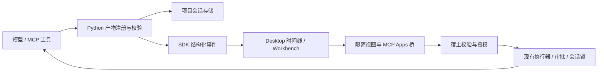

# Reverie Intelligent UI：调研、技术规格与 AI 开发交接

调研与源码核对日期：**2026-10-08**。状态：**提案，尚未实现**。适用基线：当前未提交工作树，核心与 Desktop 版本均为 `2.5.0`，核心接口版本为 `1.0`；不能用 Git HEAD 或已发布安装包代替这份工作树。

本文定义待开发能力、实现约束、分期验收和可直接复制的 AI 提示词。当前能力以 [FEATURE_STATUS](FEATURE_STATUS.md) 为准，排期及状态只在 [ROADMAP](ROADMAP.md) 维护。本文中的模块名、动作、字段与限制是 **Reverie 设计约定**，除特别注明外均不是 OpenAI 的内部实现或公开 API。

## 1. 联网核实：ChatGPT 的相关能力是什么

本次用官方文档搜索与网页搜索检索了 `ChatGPT intelligent UI`、交互式可视化、MCP Apps、插件扩展及桥接协议，并实际读取下列官方页面。**没有在本次检索到的官方资料中确认“Intelligent UI”是一个正式发布名称**；也没有证据把这些能力归到同一次新发布。本文将这个词用作 Reverie 的产品代号 RIU，而不宣称复刻一个同名 OpenAI API。

| 官方能力 | 已核实的产品行为 | Reverie 对标范围 |
| --- | --- | --- |
| [Visualizations](https://learn.chatgpt.com/docs/visualizations) | 在聊天中生成可操作的图表、地图、解释、计算器与模拟器；可主动选择，也可用 `@Visualize`；桌面预览按账户与平台逐步开放 | 对话内生成视图、滑块/筛选/选择、继续追问、离线重看 |
| [MCP Apps UI](https://developers.openai.com/plugins/build/chatgpt-ui) | 工具声明 UI 资源，宿主以隔离组件显示，组件通过 MCP Apps 桥与宿主通信 | 兼容明确测试过的标准协议子集，支持已有 MCP 服务器的组件 |
| [Plugin Extensions](https://developers.openai.com/plugins/build/extensions) | 扩展侧栏、对话面板、文件查看器、编辑器、表单与上下文联动 | 先复用 Workbench 承载扩展视图；完整第三方扩展清单与生命周期另行规划 |

Visualizations 页面明确：结果通常是生成时的数据快照；追问**可能**生成替代版本，并非保证原地修改；终端和 IDE 扩展不渲染这些可视化。页面中的 `/visualize` 是 **Space 页面编辑**入口，不能写成所有聊天都有的斜杠命令。托管应用与持久业务数据属于 Sites 等另一类产品范围。可用性、首次发布日期和当前账户开关不能从搜索结果推断。[官方使用说明](https://learn.chatgpt.com/docs/visualizations)

可移植 UI 的公开依据是 MCP Apps。`window.openai` 属于 ChatGPT 扩展接口，不是所有宿主都会具备的标准能力；“支持 MCP Apps”不能直接等同“所有 ChatGPT 插件原样运行”。工具自身必须在没有组件的客户端也有有用的结果。[官方 UI 接入说明](https://developers.openai.com/plugins/build/chatgpt-ui)

DevDay 页面列出了 Plugin Extensions，但这不能证明 ChatGPT 的可视化生成与第三方组件共用同一套内部生成器。Reverie 可以实现类似公开体验，不能承诺相同模型质量、闭源协议、账户体系或云端服务。[DevDay 2026 扩展公告](https://learn.chatgpt.com/docs/whats-new/devday-2026#plugin-extensions)

### 1.1 可用于开发的公开契约

| 契约 | 官方依据 | 使用边界 |
| --- | --- | --- |
| `_meta.ui.resourceUri`、`ui://`、`text/html;profile=mcp-app` | [UI 接入](https://developers.openai.com/plugins/build/chatgpt-ui) | 前者是工具描述上的资源指针；HTML 与 CSP 元数据来自资源内容；不能把 `ui://` 当 HTTP URL |
| `ui/initialize`、`ui/notifications/initialized`、`tools/call`、工具结果通知 | [MCP server and UI quickstart](https://developers.openai.com/plugins/build/app-quickstart) | 先协商协议与能力，再发送完整输入/结果；以固定 SDK/协议版本做兼容测试 |
| `content` / `structuredContent` / `_meta` | [Tool results reference](https://developers.openai.com/plugins/reference#tool-results) | 前两者可给模型，结果 `_meta` 仅供组件；不等于可在 `_meta` 塞宿主凭据 |
| `_meta.ui.visibility` | [Tool descriptor reference](https://developers.openai.com/plugins/reference) | 区分 `model`、`app` 可见性；客户端还须执行自身授权 |
| `connectDomains` / `resourceDomains` / `frameDomains` | [Security & Privacy](https://developers.openai.com/plugins/guides/security-privacy) | 服务端声明是权限请求，不是自动授权；嵌套页面有自己的 CSP，外层 allowlist 不约束其全部请求 |
| inline、fullscreen、pip；card、carousel | [UI guidelines](https://developers.openai.com/plugins/concepts/ui-guidelines) | 前三者为展示模式，后两者是内容布局；不应把 carousel 当标准 display mode |

读取日期统一为 2026-10-08。实施时复核对应页面和 SDK 版本；本次未安装插件或调用付费模型验证 ChatGPT 账户侧行为。

## 2. 当前项目审查与差距

以下是本次直接读取源码的结论，属于静态审查，不是重新运行完整软件后的验收结果。

| 层 | 已有实现与源码入口 | RIU 缺口 |
| --- | --- | --- |
| 对话显示 | [App.tsx](../ReverieCli-ui/src/App.tsx) 中 `Markdown` 使用 `react-markdown` 与 `remark-gfm`；处理链接与代码；`ui.event` 进入活动流 | 无生成 HTML 执行入口，也无可交互视图片段；不能通过开启 Markdown raw HTML 来实现 |
| 时间线 | [types.ts](../ReverieCli-ui/src/types.ts) 的 `TurnSegment` 只有 assistant/reasoning/activity；[live-stream.ts](../ReverieCli-ui/src/live-stream.ts) 有 40 ms 批处理及活动去重 | 要增加 view 引用、版本去重与历史恢复；不能依赖最多保留 200 条的活动数组作为唯一存储 |
| 核心事件 | [stream_protocol.py](../ReverieCli-py/reverie/stream_protocol.py)、[sdk_bridge.py](../ReverieCli-py/reverie/sdk_bridge.py) 已将标记事件转成结构化流 | 可复用传输；缺可信产物注册、view_ready/view_error 和相应能力声明 |
| 双端协议 | [core-protocol.ts](../ReverieCli-ui/src/core-protocol.ts) 与 [core-actions.ts](../ReverieCli-ui/electron/core-actions.ts) 有编译期动作完整性校验 | 新增动作必须同步类型、运行时校验、preload 与 Python 分派 |
| Electron | [main.ts](../ReverieCli-ui/electron/main.ts) 已启用 contextIsolation、禁用 Node、启用 sandbox，且有外链/导航处理；[index.html](../ReverieCli-ui/index.html) 有宿主 CSP | 这些保护不等于已建立不可信子视图的来源、IPC、资源、导航、联网和进程隔离 |
| 工具执行 | [tool_executor.py](../ReverieCli-py/reverie/agent/tool_executor.py)、[security_policy.py](../ReverieCli-py/reverie/security_policy.py)、[permission_review.py](../ReverieCli-py/reverie/agent/permission_review.py)；[main.ts](../ReverieCli-ui/electron/main.ts) 管理审批归属与执行租约 | UI 回调必须接入相同执行器与审批归属，不能直接调用底层 MCP transport |
| MCP | [mcp.py](../ReverieCli-py/reverie/mcp.py) 的 `call_tool` 保留 raw result；`format_mcp_call_result` 支持 typed media、structuredContent；[mcp_dynamic.py](../ReverieCli-py/reverie/tools/mcp_dynamic.py) 取归一化结果 | 动态目录构造没有保留 UI 描述；没有 Apps 握手、资源宿主、visibility 或结果 `_meta` 专用通道；空结果兜底序列化 raw result 须避免泄露 `_meta` |
| 会话 | [session/manager.py](../ReverieCli-py/reverie/session/manager.py) 保存 messages/metadata，支持 fork/rewind/delete；[storage.py](../ReverieCli-py/reverie/storage.py) 定义项目数据位置 | 缺不可变视图产物、版本/回合归属、UI 状态及删除/分叉的引用管理 |
| 面板与 CLI | [Workbench.tsx](../ReverieCli-ui/src/Workbench.tsx)、[ConversationDisplay.tsx](../ReverieCli-ui/src/ConversationDisplay.tsx)、[cli/interface.py](../ReverieCli-py/reverie/cli/interface.py) | 可以复用面板与显示偏好，但 Workbench 还不是通用插件宿主；TUI 需要摘要降级 |

结论：基础传输和宿主已经具备，新增工作集中在**视图产物、隔离执行、可信交互、会话生命周期**。G24 记录的是更广泛 MCP 客户端边界，RIU 完成只关闭其中 UI 相关部分；单独登记 G33，避免把 roots/sampling/elicitation/OAuth 一并误标完成。

## 3. 产品内容与完成定义

### 3.1 用户应能完成的完整流程

1. 用户要求“解释这个算法并让我调参数”或“把这组数据做成交互图表”；模型在有帮助时选择 `render_view`，一般事实问答仍输出普通文本。
2. 回答中出现有标题、简短摘要和可交互内容的视图；滑块、筛选、排序等本地操作立即反馈，不逐次请求模型。
3. 用户可以放大到 Workbench，继续用正常输入框追问；新内容形成一个可追溯版本，旧版本仍可查看。
4. 对允许的视图操作，宿主展示清楚的动作来源，经现有审批执行工具或发起新对话；模型只接收与问题有关的选择摘要。
5. 刷新、重启、切换会话后能恢复产物与展示状态。CLI/旧客户端收到可读摘要、数据解释与产物引用。
6. MCP Apps 服务以公开标准返回组件；在实现所声明的兼容子集内，原有组件无需改成 Reverie 专有桥。

### 3.2 范围与优先级

| 编号 | 必须交付 | 阶段 |
| --- | --- | --- |
| F01 | `render_view` 注册本地自包含 HTML；含文本摘要/数据来源与版本；原子持久化成功后才发布事件 | MVP |
| F02 | 对话 inline 视图、加载/错误/禁用状态、键盘操作、亮暗主题、窄窗口 | MVP |
| F03 | 严格隔离、默认离线、宿主可销毁、参数校验、跨会话访问拒绝 | MVP 前置门 |
| F04 | 重启恢复、取消、fork/rewind/delete、旧客户端文本降级 | MVP |
| F05 | 受控工具回调、用户触发追问、模型上下文摘要、私有 UI 状态 | 第二阶段 |
| F06 | MCP Apps 标准子集及现成示例互操作、结果 `_meta` 分离 | 第三阶段 |
| F07 | fullscreen/Workbench 与 pip，card/carousel 布局；移动布局时状态不丢失 | 完整 RIU 验收 |

MVP 完成不等于完整 RIU 完成。Plugin Extensions 的第三方侧栏注册、文件编辑协议、富表单协议、远端 OAuth、托管分享、云端同步另列扩展范围；此次文档不授权顺带实施这些模块。后续若要求完全对齐这些能力，须分别补充其清单、权限和测试，不能将现有 Workbench 重命名后视为已实现。

首批代表场景为：带筛选的数据表/图表、带参数的解释器、带选择状态的比较卡片。MVP 不新增专用图表 DSL、完整页面搭建器或包管理器；HTML 只用打包资产或内联资源，依赖按实际场景引入。

## 4. 核心架构与数据契约



### 4.1 产物与消息分离

新增 `reverie/views.py` 管理产物，`reverie/tools/render_view.py` 作为小型工具入口；不要把存储、桥、MCP 兼容都塞进 `App.tsx` 或 `sdk_bridge.py`。

建议 `render_view` 输入为 `artifact_path`、`title`、`summary`、可选 `replaces_view_id`。文件由现有文件写入工具生成；注册时只接受当前工作区内已存在的 UTF-8 HTML 普通文件，安全打开后将读到的同一份字节验证并复制到宿主管理的产物目录。不要让模型选择存储目标、session_id、权限或网络 allowlist。新工具通过 [tools/registry.py](../ReverieCli-py/reverie/tools/registry.py) 和现有模式/工具发现机制加载。

建议目录：`<project_data_dir>/views/<session_id>/<view_id>/<revision>/`，内含 `manifest.json`、`index.html`，UI 状态另存。沿用 `storage.py` 确定 project_data_dir，不能直接假设工作区根目录的 `.reverie/` 是权威位置。

内核持久 manifest 示例，所有身份字段均由宿主生成/绑定：

```json
{
  "schema_version": 1,
  "view_id": "generated-id",
  "revision": 1,
  "session_id": "host-bound-session",
  "turn_id": "host-bound-turn",
  "tool_call_id": "originating-call",
  "title": "参数变化演示",
  "summary": "调整参数查看结果；输入数据来源见说明。",
  "source": {"kind": "generated"},
  "mime_type": "text/html",
  "entry": "index.html",
  "sha256": "digest-of-stored-bytes",
  "created_at": "ISO-8601 timestamp",
  "replaces_view_id": null,
  "policy_id": "local-offline-v1"
}
```

MCP 来源增加 `server_id`、`connection_generation`、`resource_uri`、资源版本/哈希，MIME 为协商支持的 `text/html;profile=mcp-app`。缓存键至少包含服务器身份、连接代次、资源 URI 与内容哈希，不能仅用可能跨服务器重复的 URI。服务端声明的权限与宿主实际授予的权限分开保存。

默认限制是实现起点，须通过测试后固化：单 HTML 2 MiB、私有 JSON 状态 64 KiB、模型摘要 8 KiB、bridge 消息 256 KiB；目录含全部资源的总额也要有限制。注册拒绝超限、无效 UTF-8、目录、外部路径、设备路径和链接逃逸，并返回可操作的错误。

**上下文成本边界**：模型生成 HTML、文件写入工具参数以及原有工具调用历史仍可能产生并保留 token。目标是“不要在工具结果、历史重放、会话加载和检索里再复制完整 HTML/私有状态”，不是“生成 HTML 不占 token”。不可删除工具调用原文来伪造低使用量；若后续做历史压缩，必须保留调用配对、签名和真实 API usage。

### 4.2 事件与 API 边界

`view_ready` 只携带 view 引用、标题、摘要和归属，不携带 HTML；`view_error` 携带关联 id 与脱敏错误。新增 `TurnSegment` 的 `view` 分支；按 `(session_id, turn_id, view_id, revision)` 去重，保证文字、思考、工具和视图按原发生顺序显示。

UI 的事件标记只通知“有产物可读”，不是权限凭证。任意模型文本、日志或 MCP 返回里伪造 `[[REVERIE_EVENT]]` 都不得创建可执行视图；Desktop 必须通过核心验证注册记录和会话归属。

拟新增核心动作：

| 动作 | 作用 | 服务端必须验证 |
| --- | --- | --- |
| `getView` | 读取安全 manifest/内容描述 | 当前 project/session 与 view 归属、存在性、大小、哈希；不接受任意文件路径 |
| `setViewState` | 保存 JSON 展示状态 | view 版本、state_revision、大小；陈旧写入返回冲突，不覆盖新状态 |
| `callViewTool` | 从组件调用绑定工具 | 用户操作来源、工具白名单、server 绑定、schema、权限、取消和执行租约 |

内部 payload 命名沿用现有 TypeScript `sessionId` 等约定；持久层可用 snake_case。跨层映射显式编写并测试。追问复用正常 `runPrompt`；不要增加可以绕过现有调度器的第二条聊天入口。

握手新增可选 capabilities，例如 `views: {schema_version: 1, inline: true, mcp_apps: false}`。feature detection 决定工具是否提供可视化能力；TUI仍可生成文件并返回摘要。新增兼容字段不应盲目改动 `CORE_INTERFACE_VERSION`：先验证旧新内核组合；真正破坏协议时才升版并同步可信内核元数据、打包与兼容性测试。

### 4.3 渲染隔离：必须先验证的技术门

候选实现是宿主拥有的 `reverie-view:` 资源协议，加 `sandbox="allow-scripts"` 的 iframe；不给 `allow-same-origin`、顶层导航、弹窗、表单或下载权限，不加 preload，不暴露 Node 或 `window.reverie`。父页面仅增加必要的 `frame-src`，不放宽父页面 `script-src`，不关闭 `webSecurity`。

**iframe 只是候选，不是已经证明的资源隔离。** Phase 0 必须在打包 Electron 中用无限同步循环和高频消息验证：聊天仍可输入、Stop/关闭视图仍可用、主进程能销毁视图。opaque origin 与 iframe sandbox 本身并不保证独立进程。若达不到这些门槛，使用独立 sandboxed WebContentsView/BrowserWindow 承载，隔离 session、禁用 preload，并通过可信包装层转发有限消息；不能以普通页面超时定时器声称解决死循环。其 inline 布局与生命周期成本在同一技术门内验证后定案。

离线响应 CSP 起点：

```text
default-src 'none'; script-src 'unsafe-inline'; style-src 'unsafe-inline';
img-src data: blob:; font-src 'none'; media-src data: blob:;
connect-src 'none'; frame-src 'none'; worker-src 'none';
object-src 'none'; base-uri 'none'; form-action 'none'
```

这允许隔离视图中的内联脚本，不允许宿主执行该脚本。CSP 不是全部权限边界：主进程还要拒绝子视图自导航/重定向、window.open、下载、协议跳转、摄像头/麦克风/定位/通知等权限请求；`connect-src 'none'` 不能单独证明没有导航或外传路径。

资源协议只能按已绑定的 view ID 和入口映射取文件，检查 Windows 盘符、UNC、编码路径穿越、junction/symlink 及检查后替换问题；不能提供通用 `file://` 读取代理。所有有特权的 Electron IPC 都须校验 **senderFrame/顶层宿主身份**，不能只看 `event.sender` 或认为子 frame 没 preload 就绝对安全。

### 4.4 桥：优先标准，最少私有扩展

内置生成视图与 MCP 视图共用宿主执行控制器。对第三方保持标准 JSON-RPC 方法，避免先造 `riu/*` 再声称与 MCP Apps 自动兼容。标准名称不代表完整协议已经实现；实现时固定 SDK/规范版本及 capability profile。

| 方法/生命周期 | 宿主行为 |
| --- | --- |
| `ui/initialize` → `ui/notifications/initialized` | 协商版本、hostContext、主题/语言/尺寸与能力；就绪前排队有限条消息 |
| `ui/notifications/tool-input` / `ui/notifications/tool-result` | 审批完成后发送当前实例输入与结果；同一数据更新尽量保留视图实例 |
| `tools/call` | 仅执行该组件所属服务器、当前启用且允许 app 可见的工具；走 `callViewTool` |
| `ui/message` | 用户操作触发时进入常规追问流程；组件启动或自动定时器不能冒充用户发送 |
| `ui/update-model-context` | 记录有大小上限、带视图来源的选择摘要；视为不可信用户数据，绝不升级为系统指令 |
| 展示/尺寸/hostContext 更新 | 只声明实际实现的协议能力，夹取尺寸并节流；拒绝非法/未知请求，返回 JSON-RPC 错误 |
| 私有 `reverie/view-state` | 仅内置视图用，feature-detect；映射 `setViewState`，不冒充标准持久化 API |

iframe 模式验证 `event.source === registeredFrame.contentWindow`；opaque origin 的 `"null"` 本身不是身份。绑定随机实例 capability、session/view/revision、请求 id 和握手状态；导航、重载、切换会话时使旧实例失效。发送给 opaque frame 时若必须用 `targetOrigin="*"`，仍必须限定目标 window，且不发送宿主密钥。独立 WebContents 模式使用相同约束的受控消息通道。对消息大小、速率、并发、超时、重复和取消均有上限。

### 4.5 工具调用、权限和状态

视图不是新的授权主体。权限取“用户已授予的权限、当前模式/工作区策略、组件允许范围”的交集；`readOnlyHint`、组件声明与隐藏 `_meta` 都不能绕过审批。用户点删除按钮不应在 iframe 内伪造一个确认框就算通过；复用宿主审批，展示服务器、工具、目标、来源视图，审批回到正确的 worker。

回调需进入现有 execution-coordinator/worker pool/session 锁和审计链。会话忙时显示忙碌或使用有界队列，不并发改写同一会话；Stop 取消排队、审批等待和正在运行的工具，并使迟到结果无效。相同实例/request id 的写操作不得重复执行；重启后遇到状态不明的写请求先查询结果，不自动重放。

三类数据分开处理：

- 业务数据归 MCP 服务或工具所有，更新后回传权威结果；视图不得把缓存当真实业务状态。
- UI 状态如页签、筛选、缩放交宿主持久化，默认不给模型；模型可见的选中摘要需通过明确通道。
- HTML、资源、私有元数据进入产物存储；模型请求只包含正常结果/摘要，不自动附带完整模板、历史 UI 状态和敏感路径。

对 MCP 在 `format_mcp_call_result` 与 `MCPDynamicTool` 两边建立明确的“模型数据 / 视图数据”分流；特别测试只有 `_meta` 的结果，禁止兜底 `json.dumps(result)` 泄露组件私有数据。工具定义 UI metadata、资源 UI metadata 与结果 `_meta` 是三个不同层次，须分别保存和校验。

MVP 生命周期采用最简单可靠方案：版本不可变；fork 只复制分叉点前可见视图及状态、重新绑定所属会话；rewind 隐藏后续引用；删除会话只删除其自有产物。先不引入跨会话共享文件和引用计数 GC。中断注册未提交的临时目录可回收；已经提交的旧版本不因失败重试被覆盖。重启后恢复历史产物，但不自动执行工具或重放写操作。

### 4.6 网络、兼容与性能

MVP 自包含且离线。MCP 阶段如需联网，将资源声明的域名与用户已授予范围求交，按资源类型生成策略；不默认放行全部 HTTPS/CDN/localhost。远程资源重定向、子 frame、DNS/回环地址和服务端 fetch 路径分别处理。Cookie、OAuth token 与模型 API key 留在可信服务端；联网或所需扩展未获准时明确显示限制与文本结果。

先支持 `_meta.ui.*` 和标准桥，`openai/outputTemplate` 仅为明确标注的资源指针别名。`window.openai` 的 checkout、文件上传、modal、widgetState 等不是默认兼容项。只使用专有桥的组件须提示不支持或进入经单独测试的适配器。完整插件兼容不因一个 dice 示例通过而成立。

加载时按需挂载，离屏动画暂停；不因流式文字变化不断重挂。关闭视图要释放监听器、MessagePort、计时器和资源。建议验收目标：固定 Windows 主机、小型离线样例（HTML ≤200 KiB、数据 ≤1,000 行），产物提交到可交互 P95 ≤1 s；本地控件输入到绘制 P95 ≤100 ms；100 条历史视图仅挂载可见/活动实例。记录硬件、样本数与 P50/P95；这是待测目标，不是目前性能承诺，也不含模型生成耗时。

主题由 hostContext/CSS tokens 提供；对比度按 WCAG AA 设计，控制有名称/键盘焦点/文本等价，尊重 reduced motion、语言切换和 1080×700 产品窗口。carousel 的项目数量与卡片操作数量参照官方指南，但不机械禁止所有内部滚动、自定义视觉或大数据视图；重点是清楚的宿主导航与可访问性。

## 5. 分期与验收门

阶段顺序是依赖关系，不是完成报告；状态统一见 [Roadmap 的 RIU 项](ROADMAP.md#intelligent-ui)。

| 阶段 | 交付与主要文件 | 必须通过才可继续 |
| --- | --- | --- |
| P0 隔离与协议试验 | 新 `electron/view-host.ts`、最小 fixture、打包配置；明确 iframe 或独立 WebContents 选择 | 真实 Electron 权限/导航/IPC/死循环隔离；开发态与安装包都能加载离线资源 |
| P1 纵向 MVP | `views.py`、`tools/render_view.py`、registry、stream_protocol、sdk_bridge、core-protocol/core-actions、types/live-stream、独立 `InteractiveView.tsx`、App 接线 | 工具→持久化→事件→交互→重启；TUI 摘要；旧客户端降级；没有 raw HTML 注入 |
| P2 交互与生命周期 | preload/main 的受限桥、执行调度、审批、SessionManager、会话/显示缓存 | 真实用户操作、审批拒绝/允许、Stop、fork/rewind/delete、重复和过期回调、状态隔离 |
| P3 MCP Apps | mcp.py、mcp_dynamic.py、resource/cache/bridge、声明的标准兼容 profile | 一个不改代码的公开标准示例加恶意/失败 fixture；隐藏 `_meta` 不泄漏，工具无 UI 仍能工作 |
| P4 体验与发布验收 | Workbench、ConversationDisplay、i18n、styles、打包/历史记录 | inline/fullscreen/pip、状态切换、键盘/主题/窄窗、实际安装包与纯文本客户端验收 |

### 5.1 必须覆盖的行为测试

| 验收组 | 用例与失败标准 |
| --- | --- |
| 产物正确性 | 有效 HTML；超限/无效 JSON/编码/缺文件；路径穿越、UNC、junction、跨项目/会话、哈希不匹配；不发布半成品 |
| 事件与兼容 | 正文夹带事件标记不执行；重复 view_ready 只一个实例；乱序/取消后消息忽略；新旧核心/Desktop 组合；历史 schema 未知时保留摘要 |
| 用户流程 | 图表筛选和模拟器滑块；继续追问产生新版本；刷新重启；错误/缺文件可恢复；关闭视图不停止正常聊天 |
| 安全隔离 | 读取 Node/preload/父 DOM/任意本地文件失败；导航/外链/下载/联网/相机失败；伪造其他 frame/session 的 bridge 请求失败；死循环可隔离销毁 |
| 交互授权 | 限制工具被拒绝；允许操作经正确 worker 审批；schema 错误拒绝；忙碌/Stop/审批超时/断连/重复点击不产生额外副作用 |
| 会话与隐私 | fork 的状态独立；rewind 不复活后续视图；删除只影响所属会话；HTML/结果 `_meta`/UI 私有状态不混入模型请求、搜索摘要或默认导出 |
| MCP 互操作 | initialize/initialized 完整生命周期；标准元数据/别名；app-only 工具不出现在模型目录；未支持方法明确错误；离线/过大/恶意资源给文本回退 |
| 可访问性与性能 | Tab/Enter/Escape、焦点返回宿主、减少动效、中文长文/空数据/上限数据、亮暗主题、惰性加载及实测延迟 |

### 5.2 验证命令与证据

从仓库根运行 Python 和文档检查；Desktop 命令在其子目录运行，使用已有依赖环境。每阶段先跑受影响的 focused tests，再在需要时跑完整回归；正式完整功能验收需要以下门：

```powershell
python -m pytest -q -c ReverieCli-py/pytest.ini ReverieCli-py/tests
python scripts/verification/check_docs.py
Set-Location ReverieCli-ui
npm test
npm run typecheck
npm run build
npm run dist:win
```

测试项目、配置、日志和截图都在当前仓库 `.runtime/` 等隔离位置；不能复用真实用户会话或覆盖其凭据。单元测试不能替代真实打包 Electron 的 CSP、协议处理、IPC 与隔离证据。用 loopback fixture 验证本地链路，再在有有效授权/凭据时验证至少一个真实模型的工具生成流程；未做的网络、平台、IME、屏幕阅读器路径明确标未验证。

将每次实测结果追加到 [VERIFICATION_HISTORY](VERIFICATION_HISTORY.md)，结构化数据置于 `docs/verification/`。记录源基线、dirty 范围、主机、命令/退出码、通过/跳过、构建 ID、产物、模型/服务器、失败与限制，绝不复制历史通过数当作新运行。

## 6. 下一步可直接交给 AI 的提示词

以下提示词按顺序执行。**本次任务只完成调研与文档，不自动开始产品代码开发。** 每次交接只实施指定阶段；发生技术门失败时提交可复现证据与具体决策需求，不扩大到整个产品重写。

### 6.1 建议首先复制：P0 隔离验证

```text
请在 G:\Reverie\Reverie-Cli 实施 docs/INTELLIGENT_UI_SPEC.md 的 P0。
先读取项目 AGENTS 指令、FEATURE_STATUS、ROADMAP 的 Intelligent UI 项及完整规格；
检查 git status 并保留已有未提交改动。目标是验证生成式 UI 的可信宿主，暂不实现全部 RIU。

复核 main.ts/preload/index.html/core-protocol 与实际 Electron 版本。
以最小离线 HTML fixture 验证候选 sandbox iframe + reverie-view: 协议；
检查 Node/preload/父 DOM/路径穿越/子 frame IPC/导航/下载/网络/权限均被边界限制。
必须在真实打包 Electron 中测试无限同步循环与消息洪泛，证明聊天与关闭视图可用。
若 iframe 不能提供资源隔离，在本阶段改用独立 sandboxed WebContents，说明选择依据；
不得关闭 webSecurity、放宽宿主 script-src 或把 HTML 注入主 DOM。

先添加能失败的 focused tests，再实现最小宿主与受限通道。
运行相关测试、typecheck、build 和实际 Windows 包验证；隔离产物放仓库内。
将结果追加 VERIFICATION_HISTORY，更新 ROADMAP 阶段状态，明确通过/未通过及未测平台。
最终给出修改文件、实际命令/结果、构建产物与下一阶段是否具备前提。
不要提交或推送，不要顺带实现云端、OAuth、全插件宿主或重构现有 UI。
```

### 6.2 P1：模型到视图的最小完整链路

```text
继续 RIU P1，先复核 P0 的实际隔离证据。实现注册 artifact_path 的 render_view、
受限产物存储、manifest schema、view_ready/view_error、能力探测和 view 时间线分支。
身份由内核绑定；视图必须先持久化后显示；伪造文字事件不能触发任意 HTML。
复用 registry、stream_protocol、sdk_bridge、core-actions/core-protocol 和批量流更新。
实现独立 InteractiveView 组件、摘要降级、错误恢复及最小重启/fork/rewind/delete 行为。
保持已有 Markdown、流式回答、历史工具结果与 usage 计数正确。
不要宣称生成 HTML 零 token；验证 HTML 不在结果与历史恢复中被重复加入模型请求。
用一个参数模拟器和一个数据图表打通工具→存储→UI→刷新/重启→TUI。
focused tests 与真实打包运行均需证据，按规格更新集中验证历史和阶段状态；不提交推送。
```

### 6.3 P2：回调、权限与会话状态

```text
实施 RIU P2：在 P0/P1 基础上完成标准桥需要的交互控制器与 getView/setViewState/
callViewTool 动作。遵守 docs/INTELLIGENT_UI_SPEC.md 的来源、能力、大小与状态边界。
工具回调复用现有执行器、security_policy、permission_review、审批 worker 归属和会话锁；
不能直接调 MCPRuntime.call_tool 绕过现有权限链。明确用户触发的追问与组件自动消息区别。
实现私有 UI 状态和受限 model-context 摘要；旧 frame、跨会话、重复 request、迟到结果拒绝。
验证审批允许/拒绝、忙碌、Stop、断连、重启未知写状态、fork/rewind/delete；不重放写操作。
用真实 Electron 与 loopback fixture 演示点击→审批→工具→结果→恢复。
保存实际证据并更新集中历史/ROADMAP；未通过的项目不得标完成；不提交推送。
```

### 6.4 P3：MCP Apps 可移植兼容

```text
实施 RIU P3，先重读规格引用的最新官方 UI/quickstart/reference，固定 SDK 与协议版本。
在 mcp.py 目录保留工具 UI metadata/visibility，在资源层处理 ui://、MIME、CSP 与缓存身份；
在 mcp_dynamic 和结果格式化层分开 content/structuredContent 与私有 _meta。
完成声明范围内的 initialize/initialized、tool-input/tool-result、tools/call、ui/message、
model-context 和销毁生命周期；不另造 riu/* 协议替代标准。
兼容 openai/outputTemplate 资源别名；不要声称已支持全部 window.openai 或 Plugin Extensions。
使用一个不改组件代码的官方标准示例和失败/恶意 fixtures 做互操作验证。
特别检查 app-only 工具不可被模型发现、私有 _meta 不进模型、缺 UI 时工具仍有文本结果。
报告已支持/拒绝/未验证的协议矩阵、实际版本与真实打包证据；更新文档，不提交推送。
```

### 6.5 P4：完整体验与交付验收

```text
完成 RIU P4。复用 Workbench 与 ConversationDisplay 实现 inline/fullscreen/pip，
将 card/carousel 作为布局而不是自创标准 display mode；切换展示位置不丢 UI 状态。
完成主题、语言、键盘、焦点恢复、减少动效、错误提示、窄窗、长历史惰性加载与资源释放。
按规格逐条执行验收组，测量本地交互 P50/P95 和历史加载；不要把模型延迟算作渲染延迟。
运行完整 Python/Desktop 回归、typecheck/build/docs 检查，生成并实际运行 Windows 包。
在已授权且配置可用时验证真实模型/MCP 流程；缺凭据或平台时明确未验证并保持对应状态。
更新 FEATURE_STATUS 的 G33、ROADMAP、DESKTOP_GUIDE、changelog Unreleased 和
VERIFICATION_HISTORY，附 build ID/产物/命令/测试总数/风险与下一步。不要改版本冒充发布。
不得复制历史通过数字，不提交或推送。
```

## 7. 本次文档交付边界

此次完成官方资料调研、当前源码映射、开发规格、AI 提示词和文档整合；**没有实现 RIU、没有新增产品依赖、没有替换安装包**。原有草案的“官方绝无此功能”“HTML 绝不进上下文”“所有 MCP Apps 原样运行”“Workbench 等于扩展宿主”等绝对表述已改成可验证的范围和约束。

历史规格与验证内容分别集中在 [DEVELOPMENT_HISTORY](DEVELOPMENT_HISTORY.md) 和 [VERIFICATION_HISTORY](VERIFICATION_HISTORY.md)，版本日志集中在 [changelog](changelog.md)。后续直接维护本规格及这几个入口，不再为每次研究或提示词新增一份顶层日期文档。
