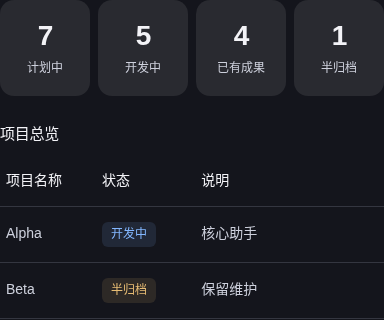
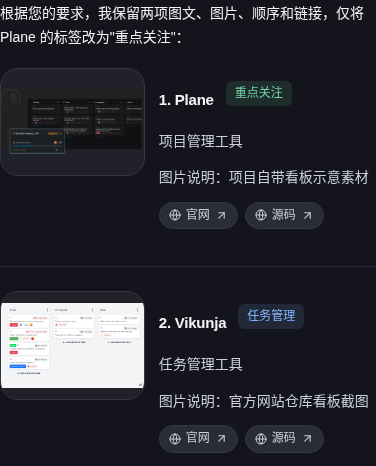
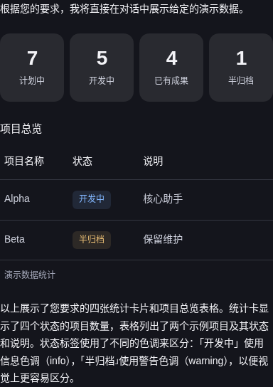
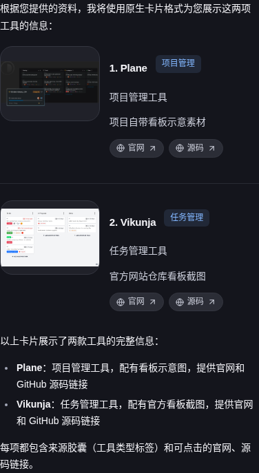

# RIU 完整目标实施快照

2026-10-26 最新补充：表单字段错误清除指引已打入隔离桌面验证包 `c059be45303a7a67`（2.5.0），Python 全量2390项通过、24项跳过；原生P2/P3/富格式/P4/隔离24/26/24/31/36项通过。deb实际安装、升级、卸载15项及AppImage extract-and-run24项通过；安装容器补齐中文字体后10张截图已查看。现有54份生成执行的截图记录全部完成，待看0份/0张。模型质量仍未达标，Windows/macOS实际系统验证仍缺失，整体未完成验收。[当前构建与修复记录](batch2-native-form-repair-c059.json)。

[最后截图复核](batch2-final-capture-review.json)与[本次补充归档索引](batch2-native-form-repair-c059-archive-index.json)已保存。新归档逐文件核验343份证据；原封存包及历史失败保持原样。

第2正式组已收尾，整体 RIU 尚未验收达标。[原始结果与人工补充](batch2-closed-results.json)为60个位置、59份完成的评测执行、1份保留的中断；原始自动31项合格，目前4项被人工否定，不能把其余27项都当作已人工验收。固定18份复核已处理；现有54份生成执行的截图均已有复核记录，待看0份/0张；中断或未执行阶段仍不算完成。Windows/macOS仍缺实际系统验证。

[24份富格式完整截图复核](batch2-rich24-visual-review.json)覆盖389张原始截图：统计总览6份、图文推荐6份的最终捕获画面均未发现遗留P2；混合回答5/6、长表2/6，共19/24。三份大模型长表始终改写编号空格；一份小模型长表保留不完整格式代码；一份小模型混合回答的正文数量与卡片矛盾。19份只是捕获画面及内容的结论，不补足未执行的操作或恢复阶段。

[后续表格原生复核](batch2-later-table-readability.json)又确认两份自动合格的页面不可通过：实际将价格上限改为200并显示缺货商品后，一份深色库存文字对比度为2.7212:1，另一份浅色缺货行文字为3.6077:1，均低于4.5:1。原检查在“只看有库存”和空结果状态下扫描，遗漏了该数据组合；当前对比度探针在显示这些行后能直接发现问题。原始模型HTML、请求和自动评分均未更改，补充诊断新增模型样本数为0。

后续[校验器修订](batch2-observer-readability-chart-revision.json)补齐缺货数据双主题扫描、CSS零值图表识别及小窗真实总量定位：完整199项回归通过；旧版本在新增24个用例中18项失败。实际原生页面确认正常零值不再误判，坐标刻度不能代替总量；20张最终原生截图均已人工查看。原始60份报告、其余591份冻结源码与3份原生产物哈希不变。[另5份交互截图复核](batch2-later-interactive-capture-review.json)覆盖178张原始图片，仍保留表单提示不清除、占位文字不可读及小窗布局问题。

冻结结束后，金额主结果、库存按钮及屏幕外绘制等待的校验器修订已应用，正式175项回归全部通过，产品源码和原生安装包未因此改变。848个真实请求的[最终来源审计](batch2-final-provenance-audit.json)确认请求/响应哈希、27个完整工具及原生采样设置；保留1条未完成流。第一次审计因记录格式兼容错误退出，原日志保留，后续只读审计另存，不改模型原始评分。

[封存索引](batch2-archive-index.json)记录当前源码包、Linux验证包哈希与4983项逐文件核验结果。原始请求、模型推理、会话和截图归档仅保存在本地 `.runtime`，不作为公开文档发布；封存不会把尚未查看的截图变成人工通过。

封存后新增的21份截图复核记录、原生诊断、最新校验器源码与当前goal/文档另存[补充归档索引](batch2-postclosure-addendum-index.json)。原封存包及其22份复核/955张待看截图的时间快照保持原样；最新待看数量为0份/0张，54份生成执行均有截图复核记录。

本轮曾在第14个位置中断：[诊断与保全记录](batch2-interruption.json)确认评测进程收到 SIGKILL，发送方和原因未知。13份已结束结果及第14份原始请求、会话和部分产物保留；第14个位置明确标为基础设施中断，不创建替代样本。同一冻结组中剩余46个未开始位置已恢复执行。该组最多有59份完整质量执行，不能把60个位置的收尾写成60份完整模型验证。

前一冻结模型组使用构建 `85ab811e5ef12ec9`，版本保持2.5.0。Python 回归2325项通过、24项跳过，桌面回归407项通过、1项跳过，校验器专项215项通过。完整 Python 回归后仅澄清一处提示词措辞，随后57项提示词合同检查通过。流式结束保持焦点、长链接换行、普通 Markdown 与富格式混排、零值、表格、链接和深浅主题的最新原生校准24项通过。

- 前一85ab构建的[原生产物、协议、互操作、隔离和 P4 检查](batch2-native-acceptance.json)通过。P4 使用合成协议样例，挂载就绪 P95为582.667ms，本地输入绘制 P95为52ms，分别20与60个样本；不包含模型生成，也不代表稳定性能结论。
- 前一85ab构建的[Linux deb 实际安装、升级、卸载](batch2-linux-install.json)15项通过，包含普通用户启动及非默认输入和私有状态保留；[命令入口补充检查](batch2-linux-launchers.json)6项通过。升级为同版本、不同原生构建的升级。
- [实际 AppImage 富格式渲染](batch2-appimage-rich.json)24项通过，使用标准 extract-and-run 模式；FUSE 挂载启动尚未验证。
- 两模型的8项独立富格式开发验证中7项通过，1项模型改写编号空格的失败保留。第1正式组整体封存于10/60：7项自动合格、2项语义失败、1项服务空流，50项未执行。共享修复后的第2整组已收尾且未达标；不合并旧成绩、不替换失败样本。
- Windows x64、macOS arm64/x64 的手动构建与原生检查工作流已准备，尚未推送或执行，缺少对应系统的实际安装证据。

第2正式组最初8份富格式样本的历史结果：自动7项合格，3项首次通过、4项经反馈通过，1项编号空格改写失败。对同8份原始会话的[固定视觉与键盘复核](batch2-fixed-rich-manual.json)为6通过、2失败：小模型混合回答把卡片改为“待办2”，正文仍写“三个待办任务”，所以人工不通过，保留原始自动评分。共享提示词修正未消除这两类模型语义问题，不能宣称模型可靠性达标。完整24份截图复核见上方补充，最新数量见 [progress.json](progress.json)。

第2正式组的[最初8份请求审计](batch2-first8-request-audit.json)和[完整工具schema审计](batch2-first8-schema-audit.json)通过：50个真实请求，27个工具完整保留，原生采样和输出默认值不变；400兼容回退、429限流和所有流记录完整保留。

交互部分的首个大模型计算器样本判为语义失败。原生副本复核确认默认往返与最初单程要求不符，深色错误提示对比度不足。另发现[初始主结果检查范围过宽](batch2-primary-amount-gap.json)：对比明细内出现正确数值时，可能误通过主结果检查；本次实际主结果为6336，要求为3168。冻结测试按原校验器完成，原始评分不变，人工结论单独保留；校验器修正已在本组结束后独立校准并应用，不替换模型样本。

小模型首份交互表格还暴露了[库存按钮校验缺口](batch2-stock-button-gap.json)：最终页面使用有名称及 `aria-pressed` 状态的按钮，原校验器只支持下拉框、复选框和开关，因此未操作就判失败。另存原生副本的6项检查通过，确认键盘空格可筛除缺货商品、与关键词组合有效。该自动失败阻止了后续修改及重启阶段，补充诊断不能证明这些未执行阶段，也不改写原评分。独立人工复核脚本曾按字典顺序选择旧页面，现已改为依据原报告的最终注册清单另存补充复核；正式评测本身已使用按发布顺序选择页面的方法。

大模型首份图表另有[零值汇总不一致](batch2-chart-zero-inconsistency.json)：新增四月100后，四个月原始数据合计460，但倍率为0时汇总回退为360。原生副本确认，最终模型 HTML 在零值分支写死了旧总量。该项自动通过，人工判为不合格；原始评分不变。这是第二项被人工复核否定的自动合格结果，不能把界面正常显示当作数据一致性达标。

金额主结果及库存按钮观察器的修订已在独立副本通过171项回归、26个 DOM 用例与两份实际模型页面的10项原生诊断。随后加入屏幕外绘制修正，扩展回归175项全部通过，另有4项原生诊断通过。修订只涉及校验器与其测试，冻结组执行期间保持原源码；[应用及正式回归状态](observer-revision.json)另行记录。这些修订不修复模型自身的图表数据错误，不替换历史样本，也不补出中断或未执行的阶段。

最新的[表单与比较页面原生复核](batch2-interactive-observations.json)继续保留失败证据：大模型表单深色占位文字对比度不足；小模型表单初始化失败，未跟随深色主题，恢复后仍残留错误提示；大模型比较页面两次修复后，深色按钮与警告文字仍不可读。两份表单的服务空流阻止了完整后续流程，能打开和操作已发布页面不能算作整项任务通过。辅助键盘检查把“按 Enter 取消已有选择”标为未选中，人工记录其实际状态变化，不据此额外判定按钮无响应。最新数量由 [progress.json](progress.json) 持续记录。

小模型首份比较任务暴露了[屏幕外绘制等待缺口](batch2-paint-observer-gap.json)：模型回复已结束，检查器却无限等待不可见 iframe 的绘制回调。记录诊断后，仅通过实际界面滚动将原视图从纵向位置7408移到150，原进程随即继续检查；没有改模型内容、输入、评分规则或重开样本。该执行保留“观察器需要视口辅助”的限制，不能宣称全自动无干预通过。现已在冻结结束后应用修订：先让 iframe 可见，再有限等待真实绘制，超时明确报错。

固定18份原生复核现已全部处理并[逐项记录](batch2-fixed18-manual.json)：7份通过、9份发现实际问题、1份受观察器误判影响而未完成，另1份因原执行中断无法取得完整最终页面。17份可用页面的全部复核截图已人工查看；这不等于18份完整任务均通过。小模型比较页面仍将不符合条件的卡片置灰显示，且小窗首屏的确认按钮被挤到下方；检查器又未识别其关联到相邻单选框的标签，因此不能根据空的自动选择记录断言单选操作本身失效。

首次 Linux 安装暴露了构建目录继承700权限的问题，普通用户无法启动。专用验证包构建脚本已统一程序目录与资源权限，并禁止推断发布渠道；修复前失败报告和包内文件哈希、权限清单均保留在本地证据中。修复后的包已实际安装验证。

第1正式组的[固定8份富格式人工复核](fixed-rich-manual.json)已完成，6份通过、2份失败；该组其余10份交互操作复核未执行；第2正式组另有固定18份复核，不能沿用第1组的成绩。除已被自动检查发现的编号空格改写，人工阅读还发现一份回答的“待办2”卡片与“三项待办”正文矛盾，不能把自动结构检查通过当成内容一致。长表格的超高元素截图存在裁切取证问题，已保留并排除该类截图，改用同一原始回答的首行、末行实际视口截图复核。

第1正式组最初8个已结束样本的[请求记录审计](initial-request-audit.json)与[完整工具 schema 审计](initial-schema-audit.json)通过：50个请求的哈希与响应记录完整，27个工具与原生采样设置保留。HTTP400兼容回退和429限流均单独记录，未改写模型成绩。

第1正式组全部10个已结束样本的[封存请求审计](formal1-closed10-request-audit.json)也已通过：139个请求哈希与响应记录完整，没有丢失流记录；400、429及空流服务错误保留，不改变原始评分。

以下是前一冻结模型组85ab构建的真实模型原始截图。统计卡与状态表首次通过；图文推荐经过两次普通反馈后通过，不能将后者当作首次生成成功。

[前一构建快照](progress-build-21b.json)及原有报告保留。以下为第1正式组、构建21b中真实模型生成的历史示例截图，没有编辑模型内容，仅用于展示当前 UI。完整样本成绩与包校验见 [progress.json](progress.json)，后续进度见[实施清单](../../RIU_COMPLETION_PLAN.md)。

本轮没有修改版本、提交推送、签名、公证或正式发布。完整请求、会话、模型产物、失败与原始截图继续保留在项目本地 `.runtime`；本页不公开原始推理流。
