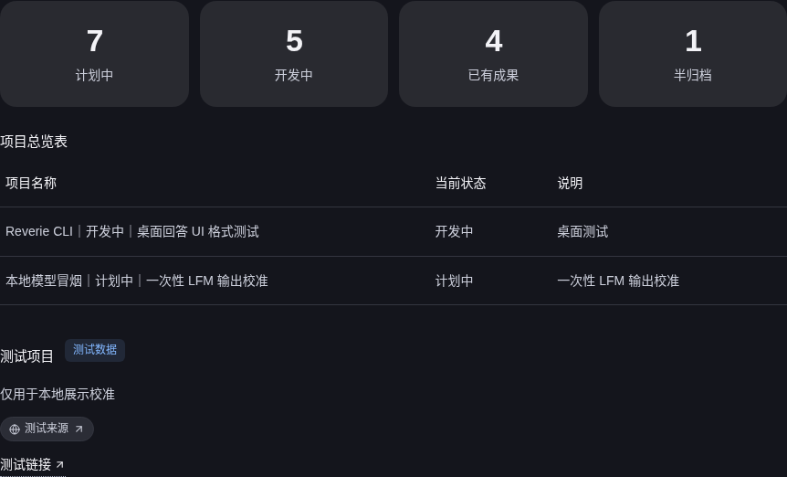
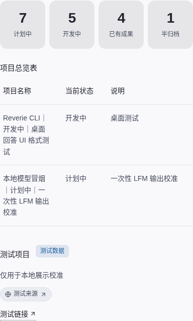

# 本地开源小模型 UI 冒烟（2026-10-26）

按用户授权复用仓库已有的本地 GGUF 权重和 llama.cpp；没有再次下载模型。四次本地 completion 被原样写入隔离会话，由最终打包桌面 `1a5c7b1a69284aaa`（2.5.0）渲染。随后又从打包桌面实际调用 loopback provider 一次用户请求，以验证生产请求路径；该请求触发两次 provider 调用，但没有生成最终用户回答。所有测试都与正式模型质量组隔离。

本次共观察到 **5 次完整的探索性模型响应**；另有 1 次 provider 调用在 2,048 个提示词 token 后取消。正式模型质量样本计数仍为 **0**：

- **LFM2.5-1.2B-Instruct**：一次回答正确复述数据但使用普通散文，没有生成富格式区块；加入精确格式示例后，模型仍把三个 JSON 对象塞进同一个围栏，并产生无效 JSON。打包 UI 安全地保留原始内容，没有误渲染。
- **Qwen3.5-2B**：默认思考模式耗尽 512 token 上限，没有用户可见的最终回答。向本地模板传入 `enable_thinking=false` 后，模型生成四个指标、一个项目表和一个推荐卡；最终 UI 在深浅主题、1280px 和 460px 视口均显示这些区块，0 个原始格式回退、0 条浏览器错误。
- **打包桌面内真实请求**：完整应用提示词约 29,442 token；首轮在 CPU 上耗时约 28 分钟，模型调用 `create_file` 写入隔离测试报告，未生成面向用户的富格式答案。随后的第二次调用预填充到 2,048 token 后被 1,800 秒保护超时取消。它验证请求确实到达本地 provider，但没有完成 UI 渲染或模型任务，不构成模型质量通过。

Qwen 的富格式输出仍有内容错误：每个项目的名称、状态和说明被合并到了表格第一列。应用内请求还暴露静态展示被模型误路由到文件工具的问题；Desktop 提示词现已明确要求静态指标、表格和推荐卡直接输出 `reverie-ui`，仅在用户要求文件或任务需要交互控件时调用相应工具。此提示词调整有单元契约检查；在2026-10-26本次记录结束时，尚未重新打包或再次模型实测。因此，这一阶段只证明原生格式解析、布局和安全回退工作，不代表回答数据正确。测试未修补模型 HTML 或 JSON，也未计入正式模型评测。

权重与模型版本按既有 manifest 校验：LFM SHA-256 `f6b981dcb86917fa463f78a362320bd5e2dc45445df147287eedb85e5a30d26a`；Qwen SHA-256 `1b04acba824817554f4ce23639bc8495ff70453b8fcb047900c731521021f2c1`。本次服务器仅监听 `127.0.0.1`，未使用密钥、外部 API 或付费服务。完整摘要见 [summary.json](summary.json)，应用内请求报告见 [in-app-qwen-smoke.json](in-app-qwen-smoke.json)，此前四次渲染检查见下面报告。

- [LFM 普通散文回退](lfm-prose-smoke.json)
- [LFM 无效 JSON 的安全回退](lfm-invalid-json-fallback.json)
- [Qwen 思考 token 上限耗尽](qwen-thinking-budget.json)
- [Qwen 富格式渲染](qwen-rich-render.json)
- 使用的本地校验脚本：[local_lfm_ui_smoke.py](../../../scripts/verification/local_lfm_ui_smoke.py)
- 应用内 provider 冒烟脚本：[local_model_in_app_smoke.py](../../../scripts/verification/local_model_in_app_smoke.py)
- 该静态回答路由的提示词契约验证：`ReverieCli-py/tests/test_prompt_contracts.py`，57 项通过。

## 2026-10-27 静态回答路由追验

在原先的提示词契约修复后，继续完成了 v5–v10 隔离实验。v5 使用 Qwen3.5-2B，虽然应用阻止了文件工具调用，但模型仍输出普通 Markdown；v6 在环境重启期间中断；v7 因 Xvfb 不可用而未发起请求；v8 的区块结构可渲染但指标和表格内容错误；v9 的表格和卡片较准确，却把标题误作指标。v10 改用本地 Qwen3.5-4B，并加强“每个统计标签和值都必须成为独立 metric item”的明确要求。

v10 在实际 Desktop 请求链路中完成一轮 **120.364 秒**的 loopback 推理，并通过精确内容检查：四项统计、完整三列表格、编号推荐卡、徽标、来源和链接均匹配合成请求。深浅主题下 1280px/460px 视口均通过布局 containment，浏览器错误为0；窄屏截图已人工检查。该临时测试包使用历史 Electron shell/ASAR 与重新构建的 Python kernel，不能替代更新后的官方 Linux 安装包。完整逐轮报告、四张截图和哈希见[静态回答路由追验](../2026-10-27-static-rich-routing/README.md)。

该追验在前一摘要所列五次探索性 completion 之外新增四次完整响应（v5、v8、v9、v10）；v6、v7 均没有响应。v4 的单独报告与前一聚合统计的边界不明确，未擅自重复计数。所有这些调用均在正式 cohort 之外，正式模型质量样本仍为0。

这些是隔离的探索性调用，不构成新的模型 cohort。双 cohort 上限仍关闭；模型语义、Windows/macOS 实机、物理辅助技术和长期稳定性仍未验收。
