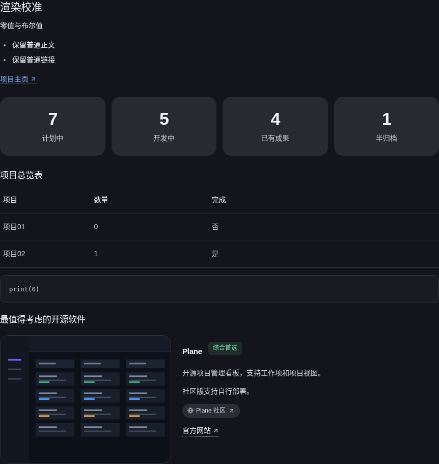
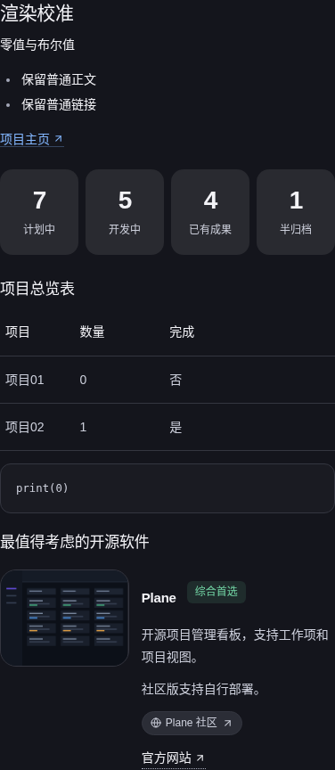
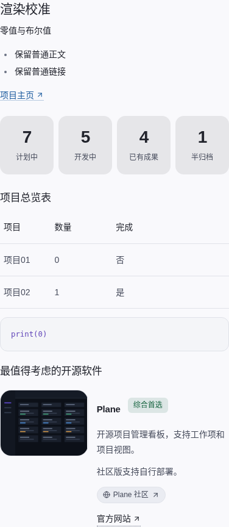
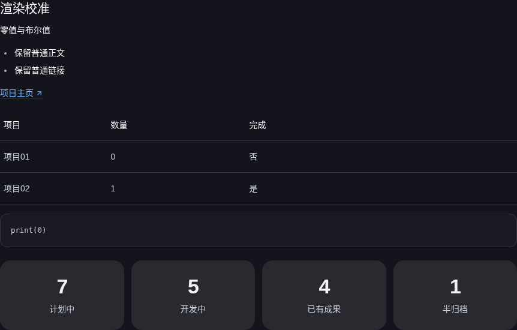
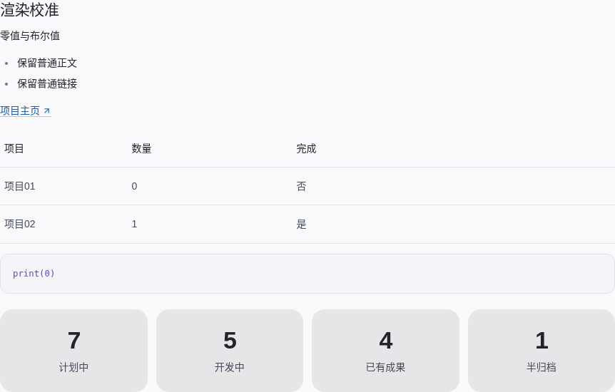
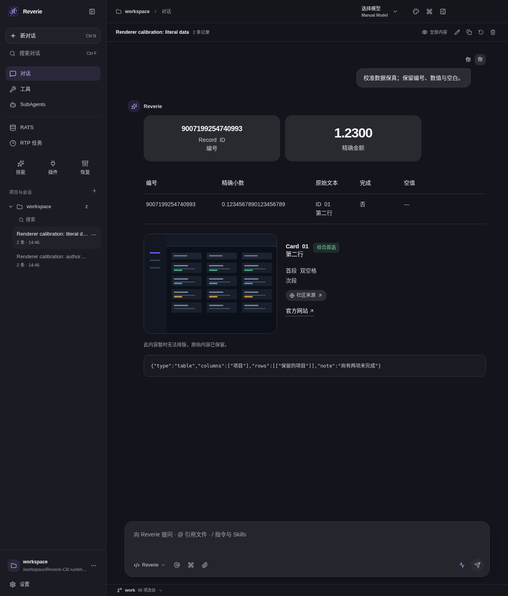
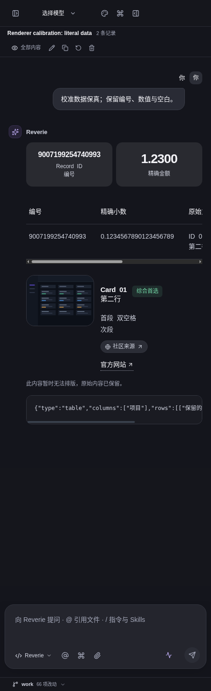
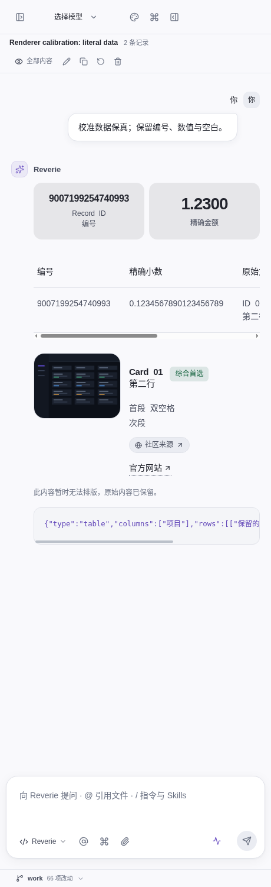

# 2026-10-26：参考图富格式回答 UI 验证

此证据针对用户强调的回答展示体验：统计卡片、项目表格、推荐图片、状态徽标、来源胶囊和链接。当前本地 Linux 桌面构建为 **Reverie 2.5.0 / `1a5c7b1a69284aaa`**。这些原生页面使用作者编写的合成校准资料，**模型质量样本数为 0**。

## 结果

- Desktop renderer：**425 passed / 1 skipped**；TypeScript 两个配置均通过。
- 同一打包桌面的原生套件：P2 **24/24**、P3 **26/26**、富格式 **61/61**、P4 **31/31**、隔离 **36/36**。
- 为验证参考图中的推荐卡片，最终原生富格式复测 **86/86**；此前单独的推荐卡片回归 **81/81** 留存。相对原61项套件新增 **25 项**，其中 **20 项**分别在深浅主题和 1280/460px 视口检查图片解码与替代文本、成功徽标、来源胶囊、官网链接及卡片容器尺寸。
- 最终 deb 在一次性容器中安装、同版本异构建升级、运行、AppImage `APPIMAGE_EXTRACT_AND_RUN=1` 校准和卸载：**22/22** 检查通过；AppImage 对应的原生富格式套件 **61/61**。
- Debian 载荷权限审计 **1494 项**通过；临时重建后的目录包 **1512 项**逐条与原快照一致，0 差异。
- 安装包 SHA-256：deb `21629b9236fd4b1b75a9180973ab5729cd5cd795f526576ff1ca9339fd060df3`；AppImage `bdd5e10cb068a1fda48ecb0df9a62539a5b4ff81c6cdbdf1cc7cf2e93864dd32`。构建版本未变，未发布。

## 截图

这组复合视图在同一答案里依次呈现四张统计卡片、项目总览表和图文推荐，最接近用户参考图：

统计卡片在宽屏保留参考图的四列布局：

推荐卡片原生页面同时显示图片、徽标、来源胶囊及官网链接；窄屏保持图文同列并限制容器溢出：

另有[浅色宽屏推荐卡片](recommendations-light-1280.png)、[深色长数值窄屏](long-values-dark-460.png)和[浅色长数值窄屏](long-values-light-460.png)。长数字保留 JSON 数字字面值并提供单行、可键盘聚焦的横向滚动；宽表格也能独立横向滚动。

> 推荐图是由测试脚本绘制的本地合成看板缩略图，仅验证打包渲染和布局，不代表真实软件截图或模型生成结果。长数值截图也刻意包含一段不支持字段的格式输入，用于确认原文回退。

## 报告

- [复合参考布局原生复测 86 项](native-rich-reference-layout.json)
- [此前原生推荐卡片复测 81 项](native-rich-cards.json)
- [最终 Linux 打包桌面 P2/P3/富格式/P4/隔离套件](native-package-suites.json)
- [deb 安装、升级、AppImage 与卸载](linux-install-upgrade-appimage.json)
- [冻结模块与 UI 产物一致性](artifact-coherence.json)
- [deb 权限审计](deb-permissions.json)
- [临时目录包精确恢复核对](package-tree-restoration.json)

完整安装文件保留在本地 `.runtime` 验证目录，未复制进 Git 证据目录。模型质量、Windows/macOS 实机、物理设备可访问性及 FUSE 挂载启动仍待验证；因此这不是 RIU 整体验收完成声明。
