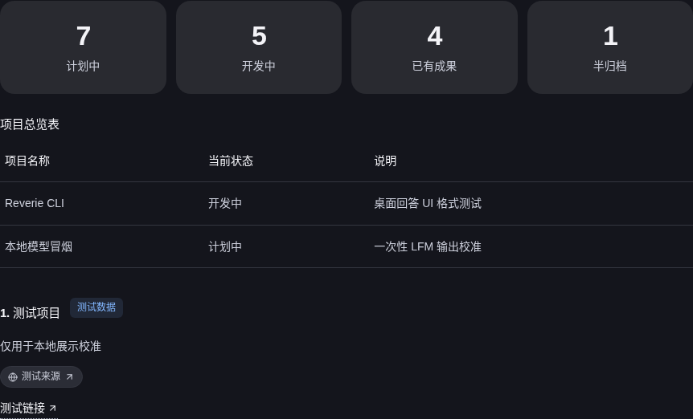
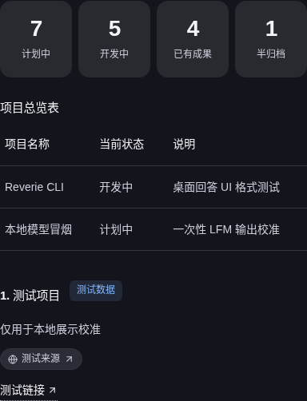
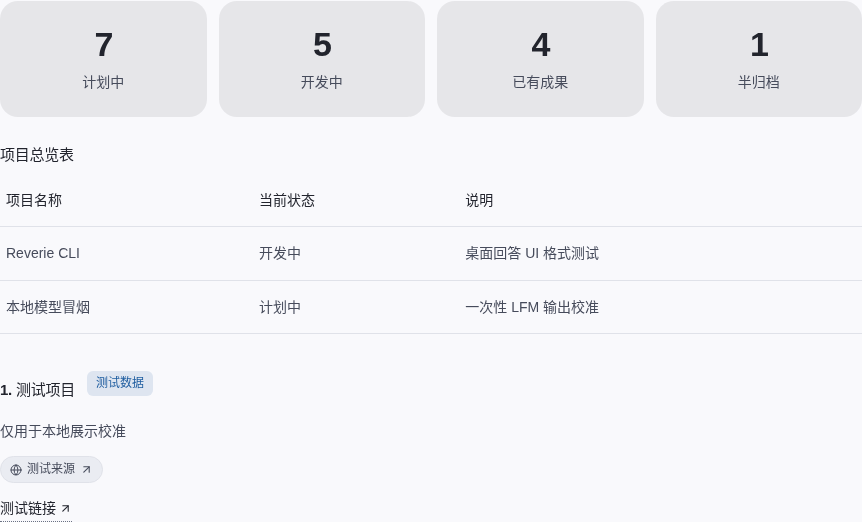
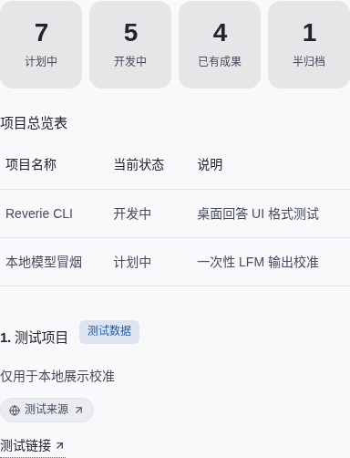

# Static rich-answer routing follow-up — 2026-10-27

This follow-up tests the user's highest-priority path: a normal request that asks for a polished, screenshot-style answer with metric cards, a project table, and a recommendation card. The app should render those structures inline without routing the request to a file or interactive-view tool.

The isolated in-app run used local `unsloth/Qwen3.5-4B-GGUF` (revision `e87f176479d0855a907a41277aca2f8ee7a09523`, SHA-256 `00fe7986ff5f6b463e62455821146049db6f9313603938a70800d1fb69ef11a4`) through a loopback llama.cpp server. It produced one complete response in **120.364 seconds**. The Desktop shell and ASAR identify historical build `1a5c7b1a69284aaa` / 2.5.0; the packaged Python kernel was rebuilt for this smoke. This is an isolated hybrid validation package, not a newly built official Linux installer. The request data is synthetic, the run is exploratory, and it contributes **zero formal model-quality samples**.

## Result

The v10 response preserved all expected content: four metric pairs (`计划中=7`, `开发中=5`, `已有成果=4`, `半归档=1`); the exact three-column project table with both requested rows; and the numbered `测试项目` card with its `测试数据` badge, source pill, and link. No fallback blocks appeared. Dark and light layouts passed containment checks at 1280px and 460px, and the browser reported no page errors. I also inspected the narrow dark screenshot: the four metrics, table, badge, source, and link remain legible and visible.

## Iteration history

| Run | Model completion | Outcome |
| --- | --- | --- |
| v4 | Qwen3.5-2B, 1 response | Created a file and returned Markdown rather than native rich blocks. Preserved as the pre-routing baseline. |
| v5 | Qwen3.5-2B, 1 response | App-side tool suppression avoided the file tool, but the answer used ordinary Markdown tables and produced no native UI blocks. |
| v6 | No response | Environment restart interrupted prompt prefill at about 76%; partial Desktop and server logs are preserved. |
| v7 | No response | Desktop exited before page startup because Xvfb was unavailable; no provider request began. |
| v8 | Qwen3.5-2B, 1 response | Native blocks rendered, but metrics and a table row were incorrect; the source label was also wrong. |
| v9 | Qwen3.5-4B, 1 response | Table and card mostly matched, but metric headings and counts were misclassified as values. The card-title verifier also needed correction. |
| v10 | Qwen3.5-4B, 1 response | Passed exact metric, table, card, viewport-containment, and browser-error checks. |

All model calls in this iteration series are exploratory. The previously archived 2026-10-26 summary counted five completions; this follow-up adds v5, v8, v9, and v10. The separate v4 report records one earlier completion, but its relationship to that old aggregate is uncertain, so it is not added to the count here. v6 and v7 produced no completion. Formal model-quality count remains zero.

## Verification and limits

The static-answer route now uses a compact dedicated system prompt, skips irrelevant tool/history/memory payload for a self-contained Desktop request, and explicitly requires every requested statistic label/value pair to become a metric item in source order. Other requests keep the existing tool-enabled path. The focused agent and prompt-contract tests passed **99/99**; the complete Python suite passed **2,392**, skipped **24**, with **14 warnings** in **405.36 seconds**. These tests verify deterministic behavior and prompt wiring, not broad model reliability.

The earlier v5–v9 failures remain in the reports below. No historical formal score was changed and no third formal cohort was started. Current-source v12 has now passed Linux AppImage rich-answer and P2 suites under a real FUSE mount (**86/86**, **24/24**), plus extracted-package P3/P4/isolation (**26/26**, **31/31**, **36/36**). The deb passed metadata/core-payload checks and a rootless Bubblewrap v11→v12 install/upgrade/removal lifecycle against the current Debian 13 dependency inventory, without `--force-depends` or host writes. Exact `package-validation.mjs` retries returned 0 for fresh deb and AppImage outputs built from the verified v12 prepackaged payload; the original builder exit-1 attempts remain preserved. One current-source local Qwen3.5-4B request also passed the exact synthetic content and layout checks and remains exploratory (formal sample count 0). See [package rebuilds](package-rebuilds.json), the current task record in [RIU_COMPLETION_PLAN.md](../../RIU_COMPLETION_PLAN.md), and [goal.json](../../../.runtime/riu-completion-20261021/goal.json). Windows/macOS real-host installs, host-level Linux install and desktop launch, physical IME and assistive-technology checks, long-duration stability and accepted formal model quality remain open.

## Current-source package rebuilds

The v11 Pillow `_imaging` failure remains preserved. The v12 clean Python 3.12.14 / PyInstaller 6.21.0 / Pillow 12.2.0 kernel SHA-256 is `d0d9f110bcd14e1bcb768933af3733f38177847bf9f0fb1ea3265923be63b5e9`; the extension is included and `--kernel-info` passes. Current Desktop build ID: `fcce0356b0365178`.

The retained v12 AppImage itself passed rich-answer **86/86** and P2 **24/24** under normal FUSE mounting. P3/P4/isolation on its actual extracted packaged Electron binary passed **26/26**, **31/31**, and **36/36**. The 20-sample P4 baseline measured 51.8ms input P95 (max 82.2ms) for 1,000 rows and 332.864ms registration-to-interactive P95. A supplementary 60-cycle synthetic P4 run passed all 31 checks: registration P95/max 286.16/360.888ms and input P95/max 47/62.9ms. It does not establish hours-long stability or provider/model performance; see the [stress report](../../../.runtime/riu-completion-20261021/package-v12-retry1-linux-20261027/p4-stress-v12-60-20261027/report.json). A local in-app Qwen3.5-4B synthetic request passed exact metric/table/recommendation semantics and dark/light 1280/460px containment (4/4, zero browser errors), 118.47 seconds; it adds one exploratory response, not formal model-quality acceptance.

The retained deb is valid `reverie 2.5.0 amd64`, and its main Electron executable, ASAR and kernel hashes match the AppImage payload. A disposable rootless Bubblewrap user/mount-namespace root then exercised the package lifecycle against the current Debian 13 dependency inventory, without `--force-depends`: v11 installed, v12 replaced it at the same package version, and v12 removed cleanly. The test checked the installed CLI links, `chrome-sandbox` mode, both kernel hashes, removal of the payload and links, and that the host package database and paths remained unchanged. Its writable root was staged under `/tmp`; host `/etc`, runtime libraries, system tools and the general share tree were read-only, with only staged package-write locations writable. Evidence: [lifecycle report](../../../.runtime/riu-completion-20261021/package-v12-retry1-linux-20261027/deb-bwrap-isolated-lifecycle-20261027.json) and [successful log](../../../.runtime/riu-completion-20261021/package-v12-retry1-linux-20261027/deb-bwrap-install-upgrade-retry5-20261027.log). A separate read-only Debian 13 APT simulation also resolved all required dependencies and planned only Reverie. This still does not verify installation into the host package database or launching the installed desktop. The original builder calls returned 1 after writing artifacts, and those logs remain. The exact repository `package-validation.mjs` later completed both fresh deb and AppImage targets with exit 0 against the verified v12 prepackaged payload; transient outputs remain on tmpfs and their hashes/logs are recorded in [package-rebuilds.json](package-rebuilds.json). Historical Xvfb, harness-path, missing-FUSE-library, incomplete-sandbox-layout and tmpfs-space failures remain in separate evidence. The overall cross-platform/model task is still open.

## Raw evidence

- [v4 report](v4-report.json)
- [v5 report](v5-report.json)
- [v6 Desktop log](v6-desktop.log) and [server log](v6-llama-server.log)
- [v7 report](v7-report.json)
- [v8 report](v8-report.json)
- [v9 report](v9-report.json)
- [v10 report](v10-report.json)
- [evidence hashes](evidence-manifest.json)
- [current-source package rebuild attempts](package-rebuilds.json)
- Runtime session links: `.runtime/riu-completion-20261021/local-qwen2b-in-app-smoke-20261027-v5` through `...-v9`, and `.runtime/riu-completion-20261021/local-qwen4b-in-app-smoke-20261027-v10`.
