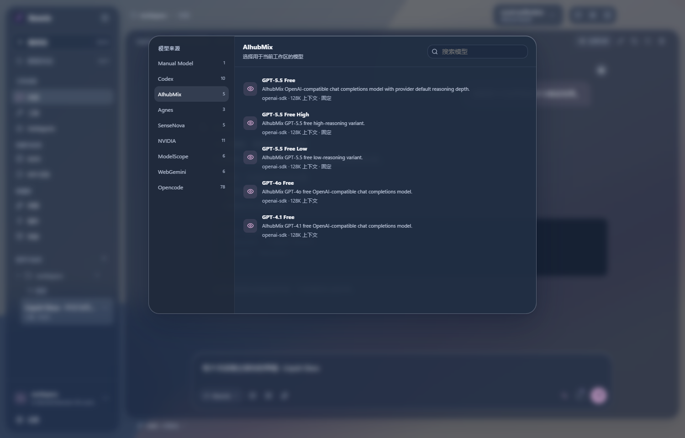
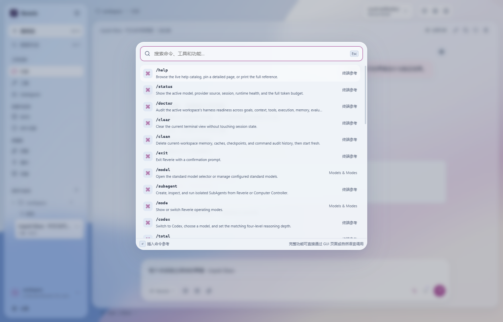

# Desktop UI polish — 2026-10-31

Version remains 2.5.3. This update replaces the assistant response glyph with a generated violet/rose glass avatar, adds interruptible transform-only sidebar/canvas motion, centers toolbar icons, restores classic wallpaper visibility, fixes the composer inner focus outline, and applies consistent materials and rounded clipping to the actual model picker, command palette, search, form and confirmation components.

Pointer sidebar motion uses 220ms drawer easing with no text scaling. Keyboard operations and reduced-motion settings bypass spatial animation. Collapsed navigation is inert. Glass dialogs use 24px outer corners, classic dialogs 20px, search/list items 12px and source rows 10px. No new dependency.

- Frontend full regression: 449 passed / 1 skipped; typecheck and production build passed.
- Latest Windows preview build `73d194f93fedac2d`: [24/24 native checks](native.json), plus [21/21 dialog checks](dialog-matrix.json). Five real dialog families were opened in classic/glass and dark/light combinations; model search empty state, Escape dismissal, rounded clipping and 1080x700 containment passed. Confirmations were canceled.
- The preceding renderer build checked [pane motion, reversal, keyboard/reduced motion, icon centering, wallpaper and focus](motion.json): 21/21, plus [long-input containment and frame progression](input-and-frames.json): 3/3. The subsequent dialog-only styles did not change those components.
- The renderer and Electron host were rebuilt in isolated directories; the previously verified 2.5.3 kernel was reused unchanged. This pass does not establish fresh Python, model-quality or cross-platform installer acceptance.
- Original failed checks and intermediate packages remain in local `.runtime`. Initial review found the reduced-motion visibility delay and missed dialog families; both are corrected in the final package. A verifier provider-name typo was corrected before the passing dialog matrix.

The pre-existing upstream rce.md worktree deletion is excluded from this publication. Runtime caches, local sessions and installation binaries are not staged. Publication outcome is verified against the remote branch in the delivery message.
