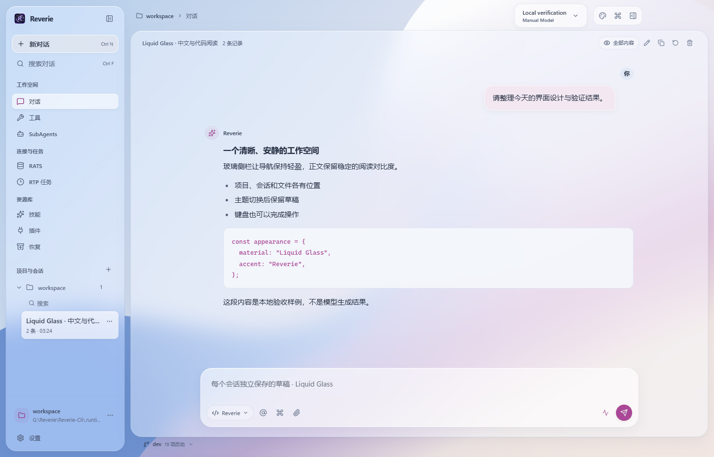

# 2.5.3 verification — 2026-10-31

This update integrates Cloud RIU (`894fe6e`) and local Liquid Glass (`0a541ab`, integration merge `7fb02cc`). It fixes light-theme accessibility material precedence and removes user names from saved and live message headings while preserving avatars. CLI/Desktop versions are both 2.5.3.

## Verified implementation

- Frontend: 449 passed, 1 skipped. Typecheck and i18n checks passed.
- Packaged Windows x64 build `9d6cfecd9909846b` built successfully in a new isolated directory.
- [Liquid Glass](glass.json): 18/18 checks passed, including opaque light/dark enhanced contrast materials, avatar-only user headings, actual file saves, three window sizes, variant switching, IPC preference isolation and reload/process-restart draft recovery; no renderer exceptions.
- [RIU Glass](rich-glass.json) and [RIU Classic](rich-classic.json): 86/86 each, including rich cards/tables/images/links, zero/boolean values, literals, long text and narrow layouts. Authored fixtures contribute zero formal model-quality samples.
- Windows package-rule tests: 2 passed, 3 Linux-only skips. Offline documentation links: 986 checked, 0 errors (before adding this report's final links).
- Python version contract tests: 145 passed after updating current-version assumptions. Final full Python regression: **2449 passed / 180 skipped**, exit 0, 374.20 seconds.
- [Product source/build hashes](source-build.json) match. The pre-existing missing optional upstream `rce.md` remains absent in the local package, and its deletion is excluded from the publication commit.

- [Windows NSIS installer](installer.json) built successfully (431,096,970 bytes). Fresh per-user installation into a project-local directory exited 0; [installed-app checks](installed-glass.json) passed 18/18. Uninstall exited 0 and removed the executable and uninstall registration. Distinct-version upgrade remains unverified.

## Evidence retained and limits

The initial frontend run had one obsolete username assertion; the corrected full run passed. The initial Python run had 2446 passes, 180 skips and 3 old-version assertions; those assertions now use the canonical version and retain old-config migration coverage. All initial logs remain in `.runtime/release-2.5.3-20261031/`.

The first fresh build failed while copying the pre-existing missing `rce.md`; its log and outputs were preserved. The retry exported the actual worktree into `.runtime/v253-retry/source/`. A concurrent Electron validation exited because of the production single-instance lock; sequential retries passed. A verification-script variable shadowing its theme helper was corrected before the final passing run.

Formal model-quality acceptance remains open under the closed two-cohort policy. No third cohort, historical rescoring or acceptance claim was introduced. Historical semantic/content failures remain evidence of model limitations; passing deterministic renderer fixtures does not close that gate. Linux/macOS host installation, physical IME/screen-reader and long-duration checks remain unverified. This Windows host has no installed WSL; it cannot substantiate Linux/macOS host acceptance.

The user explicitly authorized the version update and main publication. Main publication is a source delivery, not a claim that every historical model/platform acceptance gate passed.
